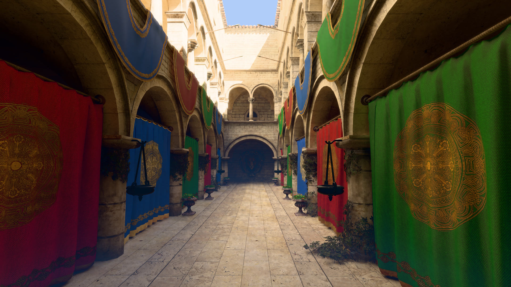
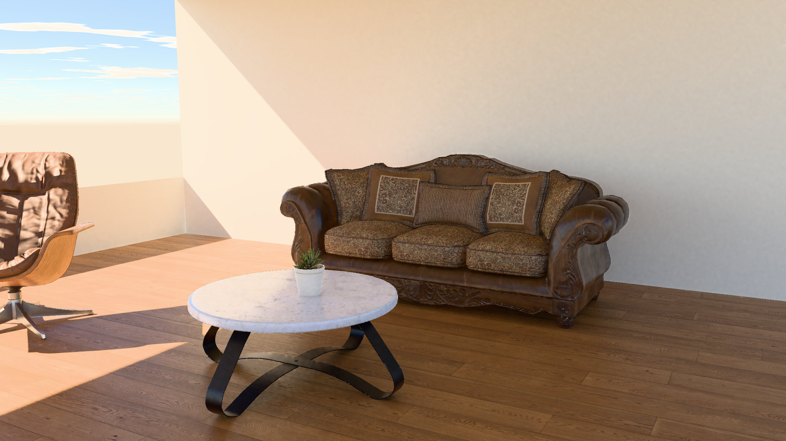
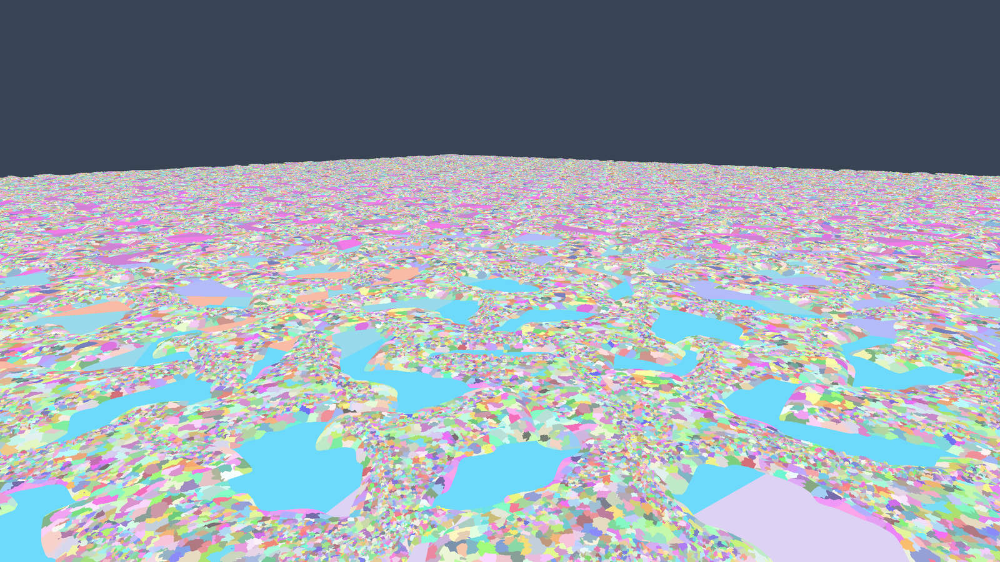
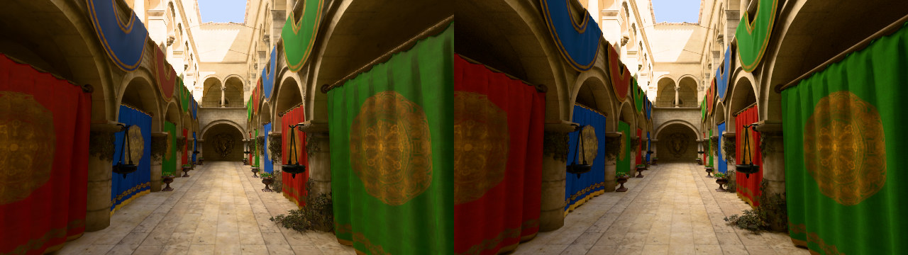
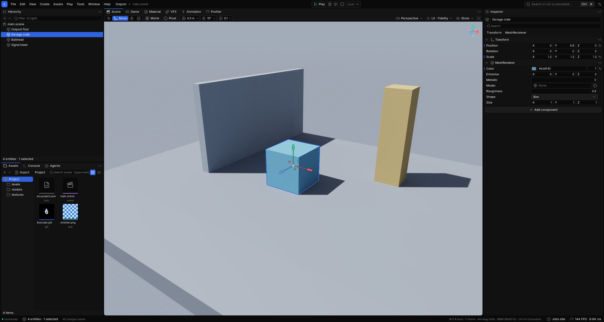
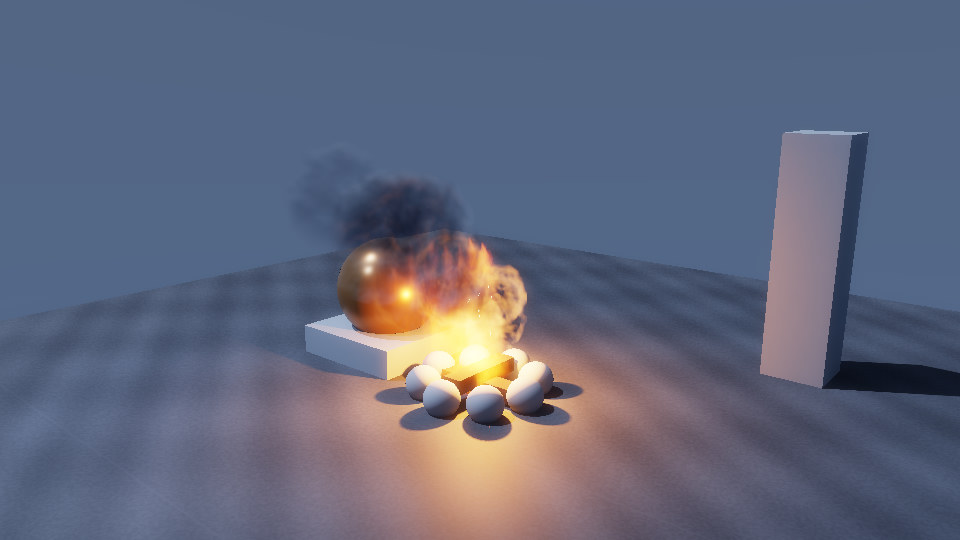
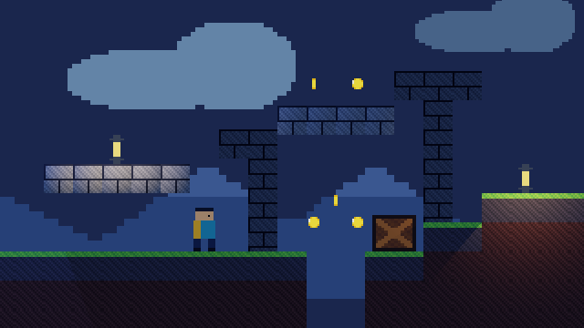
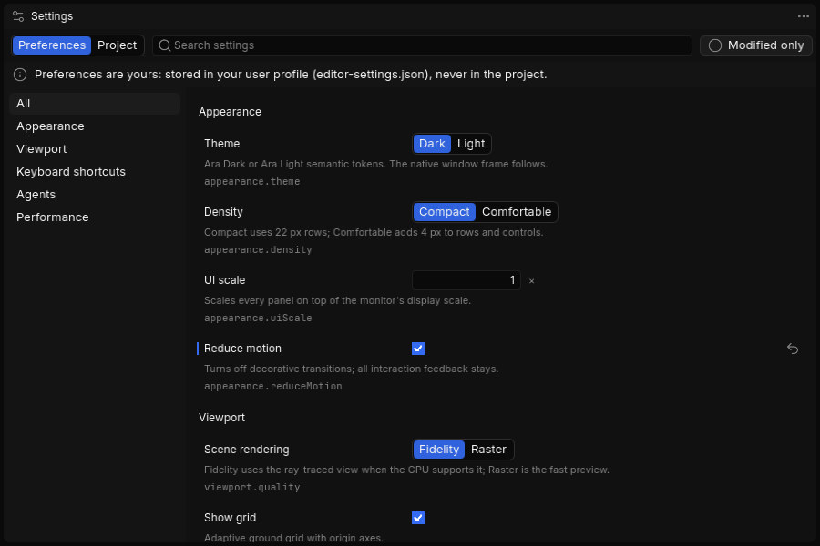

<p align="center">
  <picture>
    <source media="(prefers-color-scheme: dark)" srcset="assets/brand/ara-wordmark.svg">
    <source media="(prefers-color-scheme: light)" srcset="assets/brand/ara-wordmark-light.svg">
    
  </picture>
</p>

<p align="center"><b>An AI-native game engine in Rust.</b><br>AI agents build it. Agents and humans make games with it.</p>

<p align="center">
  
  
  
  
  
</p>

<p align="center">
  <a href="#showcase">Showcase</a> ·
  <a href="#why-ara">Why Ara</a> ·
  <a href="#by-the-numbers">Numbers</a> ·
  <a href="#status">Status</a> ·
  <a href="#getting-started">Getting started</a> ·
  <a href="#docs">Docs</a>
</p>

<p align="center">
  
  <br><sub><b>Sponza, real-time hybrid RT at 1440p:</b> 4.6% error against a 32,768-spp path-traced reference; 8.7 ms native, 4.1 ms upscaled from 960p.</sub>
</p>

## Showcase

Every image below is an unretouched engine capture; the measured number is under each one.

<table>
  <tr>
    <td width="50%"><br><sub><b>CC0 living room.</b> 3.2% error vs a path-traced reference; 6.9 ms native 1440p, 3.4 ms upscaled.</sub></td>
    <td width="50%"><br><sub><b>Virtual geometry, cluster view.</b> 1.09 B source triangles of scanned rock (1,600 instances), 4.6 ms at native 1440p.</sub></td>
  </tr>
  <tr>
    <td colspan="2"><br><sub><b>Left: Ara's real-time renderer. Right: the offline path-traced reference.</b> 4.59% whole-image relative RMSE (linear HDR, 640×360 comparison).</sub></td>
  </tr>
  <tr>
    <td colspan="2"><br><sub><b>The native editor (UX v2).</b> Dockable, detachable panels; a 272-command registry shared by menus, the palette, shortcuts and MCP; 0.08 ms CPU per idle frame.</sub></td>
  </tr>
  <tr>
    <td width="50%"><br><sub><b>GPU VFX campfire.</b> Flame, smoke and embers with a dynamic light; the same system runs 1 M particles in 1.4 ms at 1440p.</sub></td>
    <td width="50%"><br><sub><b>2D:</b> autotiled tilemaps and sprites. 100k sprites render in 0.13 ms at 720p.</sub></td>
  </tr>
  <tr>
    <td width="50%"><br><sub><b>Settings:</b> searchable, with Ara Dark/Light themes and Ara, Unreal, Unity and Blender keymap presets.</sub></td>
    <td width="50%">
      <!-- OUTPOST SLOT 1: proper-art Outpost scene, docs/media/outpost-1.jpg (≤400 KB, 1920 px) once samples/*/evidence/ lands on main. -->
      <sub><b>Coming next: <i>Outpost</i>.</b> Proper-art scenes from the co-op salvage game we are building on Ara will land here.</sub>
    </td>
  </tr>
  <!-- OUTPOST SLOTS 2–3: add a row with docs/media/outpost-2.jpg and outpost-3.jpg, captioned with measured frame times. -->
</table>

## Why Ara

Ara has five pillars:
- **AI-native**;
- **Unreal-level fidelity**;
- **Unity-level ease**;
- **a great native editor**;
- **great authoring tools for AI and humans alike.**

What makes it different:

- **Agents are first-class users, not an add-on.**
  - Every edit is a typed command that produces undoable, attributed ops. That includes edits from the editor, the `ara` CLI, C# scripts and AI agents.
  - Worlds are canonical text: JSON with `@path#id` references, which `ara merge` can three-way merge.
  - A built-in **MCP** server exposes the same commands to Claude Code, Codex and any other MCP client.
  - **`ara why`** explains a problem ("why is the Crate not visible?") from diagnostics gathered across every subsystem.
  - Agent edits simply apply, like a teammate's (D24), with undo per agent turn and a live activity feed.
- **Measured on agents.** `arabench` runs real agents through 22 engine tasks:
  - Claude Code passes 22/22 with a median of 5–6 turns;
  - Codex went from 20/22 to 22/22 after fixes;
  - with `ara why`, both agents score 24/24 on diagnosis tasks.
- **C# with sub-second hot reload.** C# 14 / .NET 10 is the single scripting language. Rust hosts .NET in the same process:
  - method-body edits reload in about 19 ms (p50);
  - a whole module swaps in about 285 ms;
  - ECS state survives every reload;
  - shipping builds use NativeAOT.
- **Its own GPU backend, not a wrapper.** `ara-gpu` is written directly on Vulkan 1.3:
  - bindless resources, a render graph and timeline-semaphore multi-queue;
  - Slang shaders cooked offline;
  - hybrid ray-traced global illumination (ReSTIR DI/GI) and virtualized geometry.

  Metal 4 is next.
- **A native editor on the engine's own UI stack.** It has:
  - a retained UI with Taffy layout and Parley text (Arabic, bidi, CJK and emoji included);
  - detachable multi-monitor panels;
  - a schema-generated inspector;
  - T3 Code-style dark and light themes.

  The same UI system renders game HUDs and world-space UI.
- **Multiplayer from day one.**
  - It is server-authoritative, with prediction.
  - Play as Host + N or Dedicated + N from the editor is being wired in now.
  - Single-player pays nothing for it.

## By the numbers

All numbers were measured on **a Ryzen 7 7800X3D + RTX 4070 SUPER on Windows 11, a shared machine** (other builds were running at the same time). Treat them as upper bounds. Each one links to its source.

| Area | Result |
|---|---|
| **Simulation vs Unity DOTS** | <ul><li>1M transforms: **0.33 ms vs 0.53 ms** (37% faster).</li><li>1M particles: **0.21 vs 0.51 ms** (58% faster).</li><li>Spawn/despawn churn: **1.11 vs 2.59 ms** (57% faster).</li><li>Boids: still 3.5–28% slower.</li></ul>Bit-exact. Unity 6 IL2CPP + Burst on the same machine. [BENCH](crates/ara-sim/BENCH.md) |
| **Animation vs ozz-animation** | 1,000 actors × 65 bones: **1.46 ms vs 1.99 ms** on 8 workers; **10.5 vs 16.6 ms** single-threaded. Clips compress 11.9× within 0.1 mm error. [README](crates/ara-anim/README.md) |
| **Virtual geometry** | <ul><li>**1.03 B triangles in 3.3–3.5 ms** at native 1440p (procedural rock field).</li><li>**1.09 B scanned triangles in 4.6 ms** native, 3.1 ms upscaled.</li></ul>[report](crates/ara-render-geo/reports/rendering-scale.html) |
| **Fidelity vs path tracing** | Whole-image relative RMSE: **Sponza 4.6%**, **living room 3.2%**, **landscape 2.7%**. Night interior went from 4.9% to **1.6%** with ReSTIR. [round 3](crates/ara-pathtrace/FIDELITY_ROUND3.md) |
| **Netcode** | **2.98 / 4.83 kB/s** down/up per client: 4 players, 50 entities, 100 ms RTT, 5% loss. It converges and passes all 6 parity/late-join/privacy gates. [S4](spikes/s4-netcode/RESULT.md) |
| **Audio** | **1,000 panned voices in 0.37 ms** per 2.67 ms block, on one core. 1,000 occluded voices with reverb take 0.46 ms, with zero allocations. [README](crates/ara-audio/README.md) |
| **Navigation** | <ul><li>**10,000 agents** (full nav tick) in **1.84 ms** on 8 workers, bit-identical across 1, 2, 4 and 8 workers.</li><li>A **10 km path** in 0.33 ms.</li></ul>[RESULTS](crates/ara-nav/RESULTS.md) |
| **VFX** | **1 M GPU particles in 1.4 ms** at 1440p (stage timestamps). [README](crates/ara-vfx-gpu/README.md) |
| **Play** | <ul><li>**Play → first tick in 3.5 ms** (p50, 5k entities) from a pool of pre-spawned players.</li><li>Live patches round-trip in about one tick.</li><li>The player survives panics and hangs.</li></ul>[S5](spikes/s5-play-process/RESULT.md) |
| **C# hot reload** | Body edits: **19 ms p50**. Additive edits: 35–41 ms. Module swap: about 285 ms. Calls between Rust and C# cost 3.5 ns under AOT. [ara-script](crates/ara-script/AGENTS.md) |
| **Agents** | `arabench`, 22 tasks: **22/22 for Claude Code and for Codex**. Median turns went from 9 to 5–6 after ergonomics fixes. [results](crates/arabench/results/README.md) |

We publish the misses too. Jolt physics, boids, the 4 ms virtual-geometry target and one fidelity timing gate don't meet their targets yet; see [known issues](docs/KNOWN_ISSUES.md).

## Status

**v0.0.1-alpha: Windows first.** This is an early alpha for testers and agents, not a production engine.

**Works today (Windows 10/11, Vulkan 1.3 GPU):**
- **The editor:**
  - hierarchy, inspector, assets and console;
  - Agents, Material, VFX, Animation and Profiler panels;
  - detachable windows;
  - Play in a separate, crash-isolated player process.
- **The CLI and daemon:**
  - `ara init`, `do`, `query`, `inspect`, `check`, `fmt`, `merge`, `why`, `logs`;
  - `ara serve` and `ara mcp` for agents.
- **Engine systems:**
  - C# gameplay with hot reload;
  - Jolt physics;
  - spatial audio (Kira, with Steam Audio HRTF);
  - navigation and crowds;
  - animation with IK and motion matching;
  - GPU VFX;
  - terrain and foliage;
  - world streaming;
  - 2D;
  - localization and saves.
- **Export:** NativeAOT game export for Windows, Linux (glibc 2.31) and Android (APK/AAB).

**Not yet:**
- Ara Hub and the global MCP;
- the engine installer;
- macOS/iOS (Metal 4);
- a tested Linux editor;
- the in-editor Game viewport;
- proper-art samples.

Read [**docs/KNOWN_ISSUES.md**](docs/KNOWN_ISSUES.md) before filing a bug.

## Getting started

### Testers: Ara Hub

> **Coming in 0.0.1-alpha.** The Hub (D25) is being built now; this is the planned flow.

1. Download the **Ara Hub** installer from this repository's Releases page and run it.
2. In the Hub, click **New project** and pick a sample (*Outpost*, *Valley*, *2D Platformer*), or **Open** an existing folder.
3. The project opens in the editor. Press **Play** to run it.
4. **Connect your AI agent once.** The Hub installs one global MCP server, and agents see every Hub-registered project:

   ```sh
   claude mcp add --scope user ara -- ara mcp     # Claude Code
   codex mcp add ara -- ara mcp                   # Codex
   ```

   Then ask your agent something like "list my Ara projects and add a lamp next to the crate in Outpost". You'll see its edits appear live in the editor's Agents feed, with undo per turn.

### Developers: build from source

**Prerequisites:**
- [Rust](https://rustup.rs). `rust-toolchain.toml` pins 1.99.1, and rustup installs it for you.
- MSVC Build Tools: the C++ workload plus the Windows SDK.
- The [Vulkan SDK](https://vulkan.lunarg.com/), with `VULKAN_SDK` set.
- The [.NET 10 SDK](https://dotnet.microsoft.com/download).

Nothing else: there is no CMake or Python, and SDL3, Jolt and Opus are vendored and built with `cc`.

```sh
cargo build -p ara -p ara-editor -p ara-player     # first build takes a while
cargo run -p ara -- init my-game                   # project + AGENTS.md + .mcp.json + starter scene
cargo run -p ara-editor -- my-game --sample        # open it in the editor
```

**Agents today, before the Hub:** `ara init` writes a per-project `.mcp.json`, so Claude Code or Codex started inside the project folder connects automatically through `ara mcp`. Agents can also use the CLI directly:

```sh
ara do entity.create -p name=Lamp --why "Light the crate"
ara why name:Lamp not visible
```

**Contributing:**
- Read [`AGENTS.md`](AGENTS.md) for the rules and local gates: `cargo check`, `clippy -D warnings`, `test` and `fmt` per crate.
- There is no CI.

## Docs

- [Decisions](docs/decisions.md): what is locked, and why (D1–D25, A1–A13, spike results).
- [Milestones](docs/plan/milestones.md): the build order, M0–M5, including the dogfood game *Outpost*.
- [Known issues](docs/KNOWN_ISSUES.md): the honest gaps in this alpha.
- [Research synthesis](docs/research/00-synthesis.md), plus ten research reports (R01–R10).
- [Brand](docs/design/brand.md) and [editor theme](docs/design/theme.md).
- [`AGENTS.md`](AGENTS.md): working rules for agents and humans. Every crate also has its own `AGENTS.md`.

## License

Not decided yet: **all rights reserved for now** (D14). The repository is private until a license is chosen.

<p align="center"></p>
