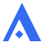

# Brand: the Ara mark

<p align="center"></p>

## The mark

**An "A" drawn with a reed pen, plus the pen's dot.** The mark has three parts:

- **A thin left leg and a thick right leg.** This is the contrast a broad-nib pen (the Arabic *qalam*) leaves on an upstroke and a downstroke.
- **No crossbar.**
- **A rhombic *nuqta* in its place.** This is the diamond dot that a qalam leaves when pressed once. In classical Arabic calligraphy (Ibn Muqla's proportioned script), the nuqta is the **unit of measure**: every letter's height and width is counted in dots.

Every part of the mark is something the pen makes, so the Arabic identity is in how the letter is built, not in an ornament stuck onto it. The mark still reads as a plain Latin "A" to everyone else. Using the calligrapher's unit of measure suits an engine whose pitch is precision and measurement.

**Rules:**
- No crescent.
- No religious motif.
- No gamepad or cube.

At small sizes the mark stays an "A" with a dot in it. It resembles none of the engine logos we checked: Unity's cube, Unreal's U-in-circle, Godot's robot, Bevy's birds, CryEngine's eye.

## Concepts considered

Source SVGs are in [`assets/brand/concepts/`](../../assets/brand/concepts/).

| Concept | Idea | Verdict |
|---|---|---|
| **C1 Nuqta A** | A symmetric chevron "A" with a rhombic nuqta in place of the crossbar. | **Chosen and refined.** It is the most legible at 16 px and the simplest. Refining it added the qalam stroke contrast. |
| C2 Alif A | An upright alif (ا) joined by a diagonal, with the nuqta in the counter. | Distinctive, but it reads as a "4" or a sail as often as an "A". |
| C3 Kufic A | A square-Kufic stepped chevron on a 5×5 grid. | Pixel-crisp, but it reads as a space invader or a robot: a game cliché. |
| C4 Khatam | An eight-point star outline with a nuqta at its heart. | Too close to the Rub el Hizb, a Quranic marker. It also suggests a badge, not an engine. |

## Geometry

The master is drawn on a 64-unit grid ([`ara-mark.svg`](../../assets/brand/ara-mark.svg)):

- **Outer triangle:** apex (32, 4), feet at x 4 and 60 on baseline 60. Both outer edges have slope 2.
- **Legs:** horizontal widths of 8 (thin) and 16 (thick). The inner apex lands at (28, 28).
- **Nuqta:** a true 45° rhombus centred at (28, 50) with a half-diagonal of 6. It sits in the optical centre of the counter, not on the mark's axis.

**Small sizes** have their own masters on a 16-unit grid:
- `ara-mark-small.svg` and `ara-icon-small.svg` are used at 24 px and below.
- They thicken the legs and widen the gaps so the nuqta survives at 16 px.

**Wordmark:** the mark *is* the "A" of **Ara**. It is followed by a geometric lowercase "ra":
- stem 9, x-height 36, on the mark's baseline;
- set as plain paths, so it needs no font.

## Colour

| Use | Mark | Text | File |
|---|---|---|---|
| Dark backgrounds (default) | `primary` #346bf1 | `foreground` #f5f5f5 | `ara-mark.svg`, `ara-wordmark.svg` |
| Light backgrounds | light `primary` #1b4ed8 | `foreground` #0a0a0a | `ara-mark-light.svg`, `ara-wordmark-light.svg` |
| Monochrome | `currentColor` | `currentColor` | `ara-mark-mono.svg`, `ara-wordmark-mono.svg` |
| App icon / favicon | white | none | `ara-icon.svg`, `favicon.svg` |

The app icon is a rounded tile (radius 14/64) with a `#4a7cf5 → #1b4ed8` diagonal gradient, so it reads on both light and dark taskbars.

## Files and regeneration

All of these are in [`assets/brand/`](../../assets/brand/):

- **SVG masters:** `ara-mark*.svg`, `ara-wordmark*.svg`, `ara-icon*.svg`, `favicon.svg`.
- **`png/`:** `ara-icon-N.png` and `ara-mark-N.png` for N = 16, 24, 32, 48, 64, 128, 256, 512 and 1024.
- **`ara.ico`:** 16/24/32/48/64/256.
- **`favicon.ico`:** 16/32/48.
- **`ara.rc`:** the Windows resource script.

The PNGs and ICOs are generated, never hand-edited. After changing an SVG master, run:

```sh
cargo run -p ara-brand -- export
```

`ara-brand` is a dev-only tool (resvg + image); no Python or ImageMagick is needed. It can also preview a single SVG:

```sh
cargo run -p ara-brand -- render <svg> <png> --size 16 --zoom 12
```

It also compresses README media (`media <in> <out.jpg> --width 1920`).

## Where the icon is wired in

- **Window icon:** `ara_platform::Window::new` sets the 64 px app icon on every SDL window (the editor, floating panels, `ara-player`) through `SDL_SetWindowIcon`. Games replace it with `Window::set_icon`.
- **Executable icon:** the `build.rs` files of `ara-editor` and `ara-player` embed `ara.ico` with `embed-resource`. That uses `rc.exe` from the Windows SDK, which MSVC linking already requires, so there is no new prerequisite. It is a no-op on other platforms.
- **Evidence:** zoomed title bars of the [editor](brand-evidence/editor-titlebar.png) and the [player](brand-evidence/player-titlebar.png), and the [whole player window](brand-evidence/player-window.jpg) (captured from `cargo test -p ara-player --test scenario -- --ignored`).
- **Still to do:** the editor's menu-bar brand tile still shows a text "a". Swapping it for the mark changes the editor's native goldens, so it is left for the next editor-chrome pass.
