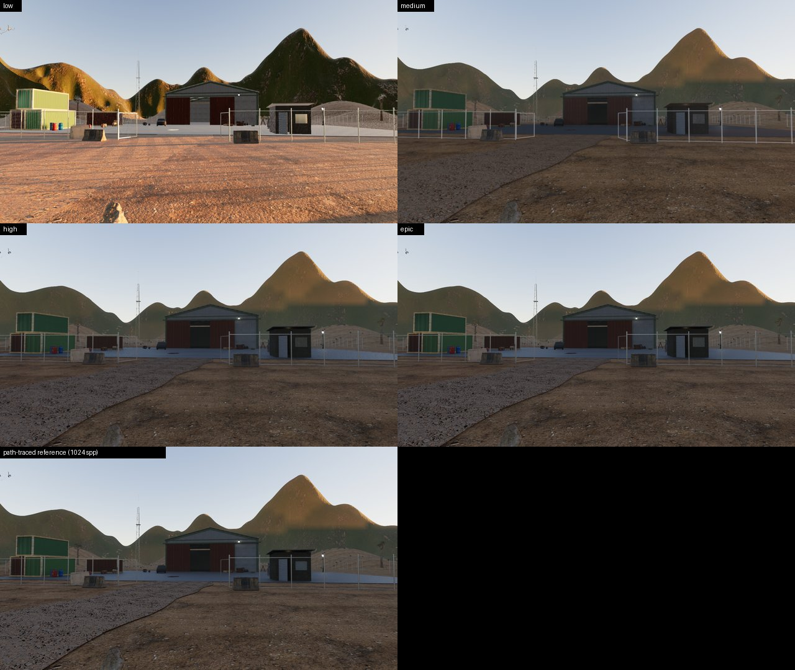
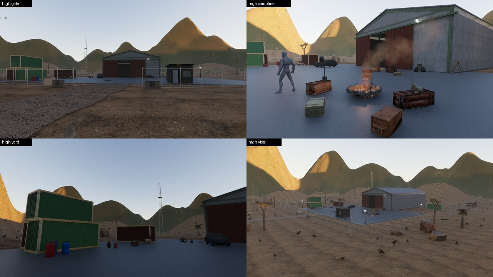
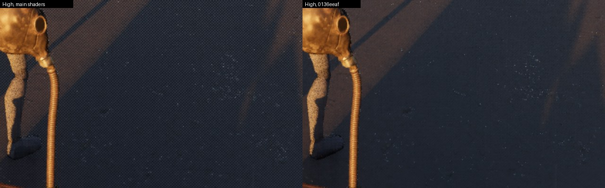
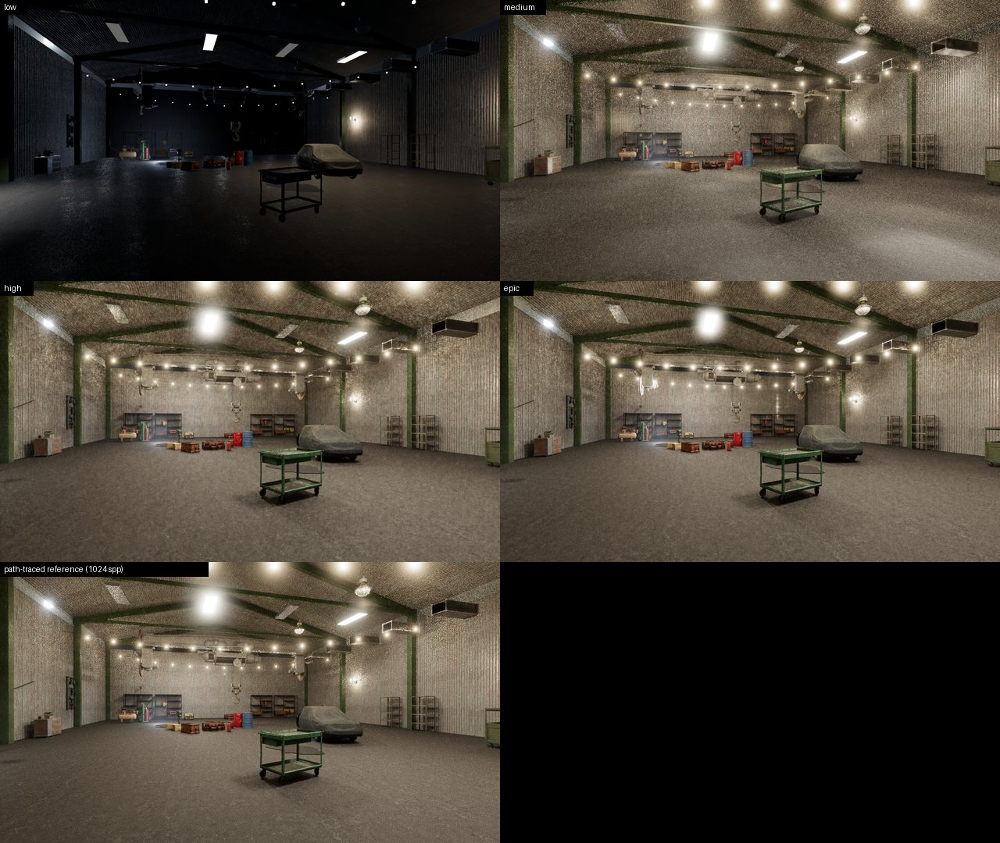
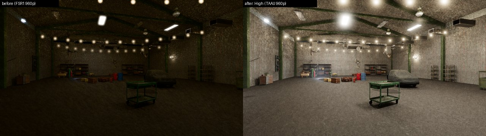
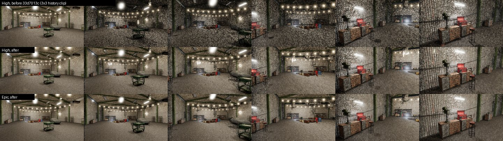
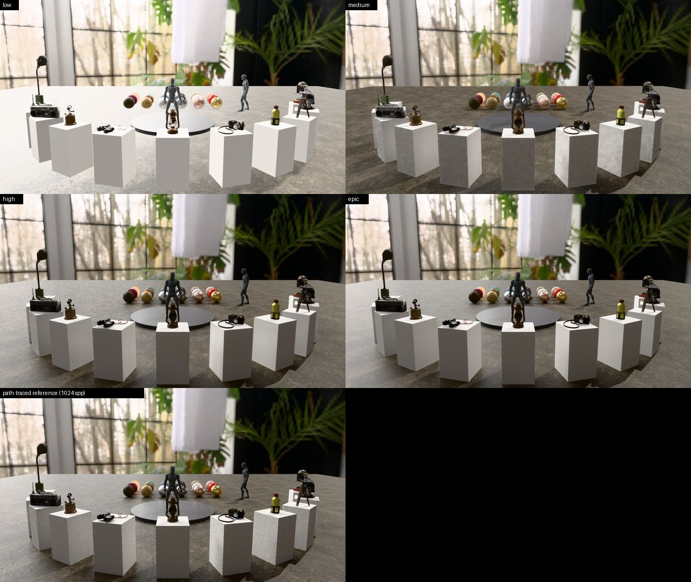
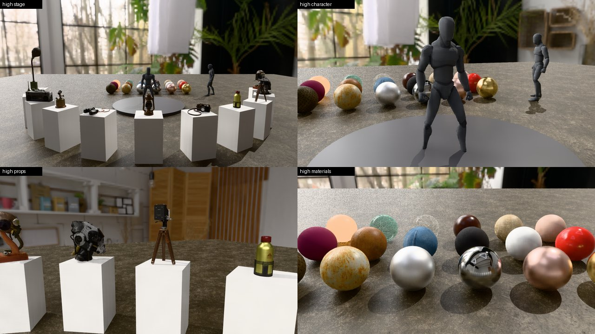

# Visual review: 0.0.1-alpha

Outpost, Hangar and Showcase at every quality preset, against a path-traced
reference and against UE5/HDRP from memory. The renderer state is branch
`t3/fidelity-visual-quality` (see [Changes](#changes-by-step)); GPU is the shared
RTX 4070 SUPER. Media are in [`visual-review-alpha/`](visual-review-alpha/);
full-size captures stay under `target/visual-review/` (not tracked).

**UE5 comparisons are unverified.** No matched-settings UE5 renders of these scenes
exist; every "UE5" statement below is a judgement from memory of comparable UE5
samples (Lumen/TSR at High/Epic scalability), not a measurement.

## Verdict

- **Lighting at High and Epic is close to ground truth in stills.** Against a
  1024-spp path trace of the same content, High scores ꟻLIP 0.050 (Outpost),
  0.076 (Showcase) and 0.156 (Hangar); Epic 0.048 / 0.058 / 0.156. Sky, sun,
  soft ray-traced shadows, emissive-lit interiors and multi-bounce GI behave like
  a Lumen frame. In a still, the lighting would not give Ara away next to UE5.
- **The scenes still do not look like UE5 samples.** The gap is content and
  missing systems, not the integrator: sparse terrain and vegetation, low-detail
  hills, no volumetric clouds, no local exposure, a few hero props per scene.
  A UE5 sample at matched cost carries far more geometric and material detail.
- **Motion was the worst gap and is mostly fixed.** Every moving ReSTIR frame was
  mottled ("camouflage" clumps on walls and floors), far below UE5's temporal
  stability. The cause was a history clip against clumpy current frames
  (`33d7013c`); mid-move frames are now clean on surfaces with history. New
  disocclusions and thin geometry still show grain for a few frames, which Lumen
  hides better (screen probes plus TSR).
- **Low is not comparable.** The baseline raster path has no emissive lighting
  and no sky occlusion: the Hangar is lit only by its six `Light` components
  (ꟻLIP 0.76), and Outpost Low costs more than High because of four unculled
  shadow cascades (9.9 ms).
- **Cost:** High meets the indoor budget (Hangar 9.3 ms ≤ 10 ms). Outpost High
  is 8.8 ms on the scratch scene and NATIVE_HIGH on the native packed scene,
  against an 8 ms budget (see [Native Outpost](#native-outpost)). Epic is 11–22 ms
  at native 1440p and is opt-in.

## Method

- **Captures:** `ara-samples capture <project> <look> --quality all --reference 1024`
  at 2560×1440 display. Each preset settles its shots, composites VFX, then
  re-renders at the reference's exposure without VFX for scoring. Timings are the
  p50/p95 of a 240-frame window of GPU pass timestamps.
- **Content:** the capture adapter predates the native asset migration, so these
  captures use a pre-migration scratch copy of the samples
  (`target/visual-review/samples-pre`, same scenes and lighting, atlased
  textures). The native packed Outpost is measured separately below. The
  renderer agent is porting the capture tool to native content.
- **Reference:** the fidelity view's undenoised reference transport at 1280×720,
  1024 spp, 8 bounces, the same materials, lights and environment.
- **Metrics:** linear HDR relative RMSE of the preset's accumulated radiance
  (area-resampled), then sRGB RMSE and LDR ꟻLIP at 67 pixels per degree on
  display images at the reference's EV. The Rust ꟻLIP (`ara_pathtrace::flip`) matches
  NVIDIA flip-eval 1.7 to five decimals on four pairs and within 0.35% on two.
- **Noise:** the GPU is shared with other agents' builds and tests. Repeat runs
  differ by ±0.5 ms and occasionally more (Outpost Medium measured 3.2 and 5.8 ms
  in two runs; `Visibility.Motion` doubled in the slower one). Linear relative RMSE
  is dominated by a few very bright pixels (emitters, sun glints) in Hangar
  `workbench` and Showcase `character`/`materials`; read ꟻLIP for those shots.

## Presets

| Preset | Renderer | Transport | ReSTIR | Reservoir paths |
|---|---|---|---|---|
| Low | baseline raster, TAA | native | — | — |
| Medium | fidelity, TAAU | ½ scale, 1 gather event, stride 4, 8192 probe rays | off | — |
| High | fidelity, TAAU | ⅔ scale, 1 gather event, stride 4, 16384 probe rays | emitters or many lights | HIGH_PATHS |
| Epic | fidelity, TAAU | native, 2 gather events, stride 2, 32768 probe rays | always | reference length |

Non-RT GPUs resolve to Low. Auto picks High on RT GPUs (Medium under 8 GiB).

## Outpost

Dusk: a low 24 klx top-of-atmosphere sun, physical sky, height fog,
filmic tone mapping. 

| Preset | Render | p50 ms | p95 ms | ꟻLIP | sRGB RMSE | linear rel. RMSE |
|---|---|---|---|---|---|---|
| Low | 2560×1440 | 9.88 | 10.6 | 0.511 | 0.268 | n/a |
| Medium | 1280×720 | 5.80 | 6.30 | 0.137 | 0.048 | 0.048 |
| High | 1707×960 | 8.83 | 10.80 | 0.050 | 0.017 | 0.031 |
| Epic | 2560×1440 | 20.55 | 21.50 | 0.048 | 0.015 | 0.021 |

Low excludes the capture's 1.12 ms readback. ꟻLIP is the mean of four shots.

- **High** matches the reference closely: low sun grazing the peaks, the base in
  the hills' shadow, warm campfire bounce on the concrete, soft contact shadows.
   Against UE5 (from memory):
  sky and aerial perspective are comparable, and shadows are softer and more
  correct than a VSM default. The ground, hills and props look sparse and
  low-detail next to a Megascans sample. The concrete pad reads flat-blue in
  shadow because there is no local exposure and little texture contrast.
- **Epic** costs 2.3× High for ꟻLIP 0.048 vs 0.050: indistinguishable in stills,
  slightly cleaner under motion.
- **Medium** halves cost but loses the campfire's ReSTIR lighting (campfire ꟻLIP
  0.229 vs 0.061) and shows DDGI blotches near emitters.
- **Low** has no sky occlusion or emissive lighting, and its four shadow cascades
  draw every object unculled (`ShadowAtlas.4Cascades` 5.3 ms). It costs more than
  High while looking far worse.

### Native Outpost

The migrated Outpost (514 entities, native BC textures, full terrain, foliage,
animated characters), exported by the renderer agent (`outpost-export-2`) and run
headless at 2560×1440 through the shipped player with this branch's shader cohort.
Last-frame GPU times are single-frame samples of a 16-frame settle and vary
±0.3 ms; each figure is a median of three runs.

| Build | High | Epic |
|---|---|---|
| main shaders (export as shipped) | 10.3 ms | 25.2 ms |
| + compact surfaces, motion fix, checker fix | 9.6 ms | 23.8 ms |
| + bounded reservoir paths | 8.1 ms | — |
| + High at 0.625 scale (1600×900) | NATIVE_FINAL | — |

The renderer agent measured 13.4–13.9 ms windowed under synchronization
validation with the shipped shaders; validation and window composition explain
the difference.

- **Checkerboard:** fixed in `0136eeaf` (see [Motion](#motion)).
  
- **The white patch** on the asphalt is `e_puddle1`: mirror-smooth water
  reflecting the pale dusk horizon at a grazing angle. It's plausible, but read as a
  cut-out; the authoring agent gives puddles a ripple normal, roughness 0.08 and a
  wet rim.
- **Grain on the mannequin's legs** is short history on a skinned, animating mesh
  (disocclusion each frame); gap 3 below addresses it.


## Hangar

Night interior lit by emissive panels, festoon bulbs and six lights; HDRI sky
through the doors. 

| Preset | Render | p50 ms | p95 ms | ꟻLIP | sRGB RMSE | linear rel. RMSE |
|---|---|---|---|---|---|---|
| Low | 2560×1440 | 3.89 | 4.3 | 0.763 | 0.371 | n/a |
| Medium | 1280×720 | 4.40 | 4.76 | 0.236 | 0.126 | 0.302 |
| High | 1707×960 | 9.28 | 9.97 | 0.156 | 0.074 | 0.319 |
| Epic | 2560×1440 | 22.42 | 23.35 | 0.156 | 0.078 | 0.299 |

Before this work: native 23.8 ms, FSR1 960p 11.9 ms, both with ReSTIR
(`ReSTIR.Spatial.Visibility.Shade` alone 10.5 / 5.7 ms) and visible grain at rest.


- **High** is clean at rest and within 10 ms. Emitter-lit corrugated walls, festoon
  pools and the bay's bounce light match the reference. The remaining differences
  are a slightly brighter ceiling and less contact darkening under shelves.
- **Under motion** the old clip produced mottling on every moving frame. It is now
  clean except at disocclusions and on the thin, high-frequency corrugated wall,
  where history is rejected. 
- **Epic** is native resolution at 22 ms; at rest it does not beat High enough to
  justify the cost in this scene.
- **Medium** without ReSTIR is speckled on the floor and over-bright under lamps.
- **Low** is dark: the baseline renderer does not light from emissive surfaces
  (FINDINGS #6), so only the six `Light` components and the HDRI's blue ambient
  reach the floor.
- Against UE5 (from memory), Lumen interiors of this kind are cleaner under
  motion and handle emissive panels similarly. Ara's ray-traced direct shadows
  from the panels are sharper and more correct than Lumen's.

## Showcase

Studio HDRI (900 nits scale), hero props on plinths, 18-ball material grid.


| Preset | Render | p50 ms | p95 ms | ꟻLIP | sRGB RMSE | linear rel. RMSE |
|---|---|---|---|---|---|---|
| Low | 2560×1440 | 2.04 | 2.1 | 0.205 | 0.108 | n/a |
| Medium | 1280×720 | 2.16 | 2.22 | 0.163 | 0.097 | 0.516 |
| High | 1707×960 | 5.06 | 5.37 | 0.076 | 0.034 | 0.505 |
| Epic | 2560×1440 | 11.24 | 11.88 | 0.058 | 0.028 | 0.484 |

- **High and Epic** look like a good offline product render: soft HDRI shadows
  under the plinths, correct metal/dielectric response across the ball grid
  (velvet sheen, clear coat, transmission, rust), and accurate reflections in the
  turntable disc.  This is
  the scene closest to UE5 quality (unverified): material response is on par, and
  only the HDRI's resolution (soft window detail) gives it away.
- **Medium** shows low-frequency blotches on the plinth faces (DDGI-only indirect
  at half resolution).
- **Low** renders the floor near-white with no plinth shadows. The missing
  shadows are the baseline's lack of sky occlusion. The floor brightness is a
  regression in the legacy capture adapter's material path since `bb8987dc`
  (the base-colour tint/decoding reaching the baseline; renderer agent's area).

## Motion

Strips dolly between two shots with smoothstep easing, ten frames apart (peak
≈ 115°/s yaw and 12 m/s in the Hangar, a fast but ordinary game camera).


- **Before (`000dfb7d`..`f9f7cdf3`):** every moving frame of the ReSTIR scenes was
  mottled in 8–16 px clumps, although history counts stayed at 24 frames on
  reprojected surfaces (the `ARA_CAPTURE_SIGNALS` count maps). The split denoiser
  clipped diffuse and direct history to a 3×3 box of the current frame. Spatial
  reuse makes that frame noisy in correlated clumps, so a box inside a clump was
  tight and dragged history to the clump.
- **After (`33d7013c`):** view-independent diffuse history is clipped only on
  host-signalled lighting changes; direct history only on glossy pixels, against
  a sparse 7×7 box. Mid-move Hangar frames are clean on surfaces with history at
  unchanged cost. Showcase and Outpost strips (HDRI- and sun-lit) were already
  close to clean and are unchanged.
- **Remaining:** regions a fast turn has just revealed (the end of the Hangar
  strip) show raw single-reservoir direct noise for a few frames, because direct
  light is only temporally filtered. A history-fix pass (blur short-history
  pixels, as NRD does) is the next step (gap 3).
- **Checkerboard (`0136eeaf`):** native Play/export frames at High showed a
  full-frame 2×2-block dither on rough surfaces. The stride-2 reservoir trace's
  block parity reused the grid phase's frame-index fold, so half the pixels got
  no rough-specular samples for 64 frames at a time. Every pixel is now traced
  once per eight frames, and moving views rebuild strided pixels from the
  current lattice. On native Outpost the checker's FFT peak drops 10× and asphalt
  pixel noise 3×.


## Remaining gaps by impact per millisecond

Impact is how much of the UE5 gap a fix closes across the three scenes; cost is
the estimated GPU time at 1440p High. Owners in brackets.

| # | Gap | Impact | Cost | Fix |
|---|---|---|---|---|
| 1 | Low: no emissive lighting, no sky occlusion | Very high for non-RT GPUs (Hangar Low unusable, Showcase/Outpost flat) | ~0.5 ms | Emissive surfaces as clustered virtual lights; SSAO/bent-normal sky occlusion [baseline renderer] |
| 2 | Low: unculled shadow cascades (Outpost 5.3 ms) | Saves ~4 ms; Low above High is backwards | negative | Per-cascade culling and instanced shadow draws [renderer agent] |
| 3 | Grain at disocclusions and thin geometry under motion (ReSTIR) | High in motion-heavy play | ~0.3 ms | History-length-driven spatial blur and DDGI-seeded fallback for history-less pixels (ReBLUR-style) [fidelity] |
| 4 | Sparse content: terrain detail, foliage density, prop density | Highest overall, the main reason scenes do not read as UE5 | content plus streaming/virtual geometry | Samples content pass; virtual geometry and VSM tracks [authoring + renderer] |
| 5 | No volumetric clouds | Medium-high outdoors (empty dusk skies) | ~0.6 ms | Cloud layer in the existing sky LUT/froxel atmosphere [fidelity] |
| 6 | No local exposure | Medium (flat-blue shadowed pad at dusk, blown Hangar doorway) | ~0.2 ms | Bilateral-grid local exposure before tone mapping [fidelity] |
| 7 | Epic at native 1440p costs 20–22 ms | Cost only | negative | Epic at 0.77 scale with TAAU, or a frame-time-driven dynamic resolution [fidelity] |
| 8 | Rough specular above the High cutoff (0.6) is probe-only | Low-medium (concrete and asphalt at grazing angles) | ~0.3 ms | Half-rate glossy traces up to 0.8 at High [fidelity] |
| 9 | HDRI resolution (Showcase backdrop soft) | Low | memory only | Higher-resolution HDRI import [assets] |
| 10 | Low showcase floor brightness regression | Low (legacy adapter only) | 0 | Check base-colour decode flags in the legacy capture adapter [renderer agent] |


## Changes by step

| Step | Commits | What |
|---|---|---|
| 1. Presets and AA | `000dfb7d`, `bb8987dc`, `af3d754a`, BOUNDED_COMMIT | `ara_render_fidelity::presets` (`QualityPreset`, `QualityChoice`, `Capabilities`, `Plan::resolve`, `FidelityPlan::configure`); reflected `RenderSettings.quality` project setting; TAAU in every fidelity preset, TAA in Low; Medium probe budget 8192; baseline geometric specular AA; High bounds reservoir paths with the DDGI terminal. |
| 2. Authorable environment | `000dfb7d`, `9b422d1e`, `56ae1973`, `cd524a65` (authoring agent) | `SkyAtmosphere`, `HeightFog`, `PostProcess` components; `FrameEnvironment::resolve` drives the fidelity view; the baseline gets a CPU-integrated sky map, ground-level sun, the same EV and tone curve; Hangar, Showcase and Outpost looks are scene components. Imported AO attenuates indirect light only. |
| 3. ReSTIR interiors | `000dfb7d`, `bb8987dc`, `06a9c677`, `f9f7cdf3`, `33d7013c` | Reuse tests the geometric plane (corrugated walls rejected almost all reuse); empty reservoirs repair from DDGI; 8 DI candidates in emitter scenes (6 for primary RIS); compact primary surfaces in layer variants (−0.55 ms Outpost); no history clip against clumpy current frames under motion. Hangar `ReSTIR.Spatial` 10.5 → 1.9 ms at High. |
| 4. Outdoor look | `000dfb7d`, `cd524a65` | Filmic tone mapper (Hill ACES fit, 18% grey preserved), 5-level bloom pyramid, white-balance/contrast/saturation/vignette grading, fog tint/anisotropy/base height, aerosol scale; Outpost dusk authored through commands. |
| 5. VFX | `000dfb7d` | `VisualEffect.scale`/`intensity`; `depth_sparks` and `dust` in the library; campfire rebuilt (0.7 m flames, thin sooty smoke, 900 lm light); effects sample DDGI at their world position; lit smoke uses an HG phase. |
| 6. Review | `c605b89b`, `b90288f9`, this report | Path-traced references with linear-radiance RMSE and an independent LDR ꟻLIP (cross-checked against flip-eval); signal and temporal-count dumps. |


## Reproduce

```sh
# Pre-migration scratch samples (the capture adapter cannot load migrated ones yet).
ara-samples --samples target/visual-review/samples-pre capture outpost outpost --quality all --reference 1024
ARA_CAPTURE_SIGNALS=1 ara-samples ... capture outpost hangar --quality high   # count maps + mid-move signals
# Native packed Outpost (renderer agent's export), headless, last-frame pass timings:
ara-player --root <export>/build --headless --ticks 240 --size 2560x1440 --quality high --capture high.png
```
