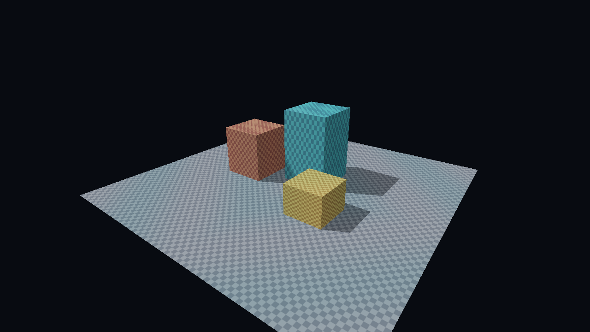

# S1: ara-gpu foundation — Windows / Vulkan

**Windows half: PASS, 2026-10-23.** Vulkan 1.3 binding, queue synchronization, inline ray tracing and offline Slang cooking work on the RTX 4070 SUPER. The same-source Metal render remains the Mac session's gate; this report does not claim a Metal pass.



## Criteria

| Windows criterion | Result | Evidence |
|---|---|---|
| Scene from Slang, bindless materials, ray-query pass, separate async compute family, working cache | **PASS** | Four materials/textures; 38 triangles; compute family **2**, graphics family **0**; timeline values **120/120**; **29,119-byte** cache reloaded from a previous process. [Headless run](evidence/headless.json), [SDL3 run](evidence/window.json). |
| Validation and synchronization validation clean | **PASS** | **0 errors, 0 warnings, 0 sync hazards** in each of three 120-frame runs. Synchronization validation explicitly enabled through `VkValidationFeaturesEXT`; Khronos layer required, never silently disabled. |
| Screenshot saved and inspected | **PASS** | [RESULT.png](RESULT.png), **1280×720 RGBA8**. Visually checked textured boxes, ground and directional shadows. Window/offscreen captures have identical SHA-256. |
| DXIL output for every shader | **PASS** | All three entry points in [scene.slang](shaders/scene.slang) emit both SPIR-V and SM6.6 DXIL; binaries and reflection are in [cooked/](cooked/). All three SPIR-V modules pass `spirv-val --target-env vulkan1.3`. |

## What was built

A standalone Rust workspace using revision-pinned ash and `sdl3-sys`, without wgpu. Headless mode creates no window or surface. Window mode uses SDL3, a Vulkan surface and a FIFO swapchain, blitting the same offscreen target before presentation. Both modes exit after a finite frame count and release their resources.

- Vulkan instance requests **1.3**. Dynamic rendering, synchronization2, timeline semaphores, buffer device addresses, descriptor indexing, acceleration structures and ray queries are explicitly checked/enabled.
- One global descriptor set: **16 sampled-image slots**, **4 storage-buffer slots**, one sampler and one TLAS. Image/buffer arrays use `UPDATE_AFTER_BIND | PARTIALLY_BOUND`; the pool/layout enable update-after-bind. Unused image slots remain unbound and are never indexed.
- Push constants are **32 bytes**: material index, texture index, buffer index, flags, deterministic phase, aspect and padding. All draws bind the same set. `NonUniformResourceIndex` decorates image/buffer accesses in SPIR-V.
- Texture slot 3 initially references the ground texture. After recording the first graphics command buffer (including binding the set), it is replaced with the yellow texture, before graphics submission. This exercises update-after-bind behavior; subsequent frames use the new descriptor.
- A compute dispatch of **4×64 threads** writes 256 `float4` material modulation values into one of four device-local buffers. The fragment shader reads that indexed buffer. Every frame copies it back and checks **all 256 values** against the CPU sine formula with a `1e-5` tolerance.
- One static triangle BLAS covers the ground and three box meshes; a one-instance TLAS references it. An explicit build barrier orders BLAS → TLAS, followed by a build → fragment-read barrier. Fragment `RayQuery` traces one opaque visibility ray toward a fixed directional light, producing hard shadows.
- GPU timestamps cover BLAS+TLAS construction, compute, raster including ray-query shading, and readback. Raster and ray queries are one fused graphics pass, so there is no separate isolated ray-query timestamp.
- Shader modules are loaded from offline artifacts. Runtime contains no shader compiler. Pipeline creation is timed with an empty `VkPipelineCache` and a disk-initialized cache; the resulting cache is persisted under `tools/`.

The driver exposes `VK_EXT_descriptor_heap`. This experiment uses the task's allowed update-after-bind descriptor-set route, whose binding and shader interfaces are sufficient for the spike. Direct SM6.6 `ResourceDescriptorHeap` access and the Vulkan descriptor-heap extension are untested alternatives.

## Exact reproduction commands

Run in PowerShell 5.1 from the repository root. The installed Vulkan SDK **1.4.363.0** supplies `slangc`, `dxcompiler.dll`, `spirv-val` and the validation layer. Rust **1.96.0** comes from the repository toolchain. No global installation is performed by these scripts.

```powershell
Set-Location spikes/s1-gpu
$env:CARGO_BUILD_JOBS = '4'
./setup.ps1
./compile-shaders.ps1 -Sdk C:/VulkanSDK/1.4.363.0
./run.ps1 -Frames 120 -Evidence evidence/headless.json
./run.ps1 -Window -Frames 120 -Output evidence/window.png -Evidence evidence/window.json
./run.ps1 -Frames 120 -NoShadows -Output evidence/no-shadows.png -Evidence evidence/no-shadows.json
cargo run --bin compare -- RESULT.png evidence/no-shadows.png evidence/capture-comparison.json
python summarize.py
cargo check
cargo clippy --all-targets -- -D warnings
cargo test
cargo fmt --all -- --check
```

`setup.ps1` downloads SDL **3.4.18**'s official VC development zip into gitignored `tools/`. `build.rs` adds its x64 import-library directory; `run.ps1` adds its DLL directory to the process PATH. Consequently even the headless executable needs that DLL on PATH. Python is needed only for the optional standard-library timing summary, not rendering or capture comparison.

`run.ps1` sets process-local `VK_LAYER_PATH` to the SDK and `VK_IMPLICIT_LAYER_PATH` to an empty local directory. Without the latter, this PC's stale PRISM Live Studio manifest registrations generate loader errors and unrelated overlays inject themselves. Nothing in the registry, SDK or system configuration is changed; validation diagnostics are not filtered out. The loader's environment override is documented in the [Khronos loader interface](https://github.com/KhronosGroup/Vulkan-Loader/blob/main/docs/LoaderInterfaceArchitecture.md).

To reproduce a run without this spike's saved cache, remove only the reported `tools/pipeline-<UUID>-<driver>.bin` file. The cache remains driver-specific and is intentionally not committed. Each run measures an empty Vulkan cache first. If a prior file exists, the warm creation uses the bytes read at process startup; otherwise it uses the just-serialized bytes. This proves both disk serialization and cross-process loading.

## Machine and measurements

[Machine record](evidence/machine.json): Windows 11 Pro **10.0.26300**, Ryzen **7 7800X3D**, **33,410,686,976 bytes** physical RAM (31.12 GiB), RTX **4070 SUPER 12 GB**, NVIDIA **617.14**. Driver advertises Vulkan **1.4.351**, while the application requests 1.3. SDK/validation **1.4.363.0**, Slang **2026.17-25-gc7954ebd1**, SDL **3.4.18**, Rust **1.96.0**. ash **0.38.0+1.4.352**, git revision **`f4c2ca3e4f6b998d5254ad101a32f024d87cdec2`**.

The final revision was run for 120 frames per mode with validation on. Discard the first 10 timestamp samples; report the remaining **110** samples, p95 by nearest rank. Timestamp period is **1 ns**, with **64 valid bits on both queue families**. GPU clocks were not fixed; other agents share the PC. These are correctness-spike timings, not production throughput claims. Raw samples are retained in each run JSON; [summary.json](evidence/summary.json) is generated by [summarize.py](summarize.py).

| GPU pass | Headless median / p95 (ms) | SDL window median / p95 (ms) |
|---|---:|---:|
| Async material compute | **0.001568 / 0.002048** | 0.001792 / 0.002784 |
| Raster + inline ray-query shadows | **0.031872 / 0.032704** | 0.032448 / 0.034208 |
| Image + material readback and barriers | **0.146912 / 0.155584** | 0.155712 / 0.171520 |

BLAS+TLAS construction: **0.104000 ms GPU** in the headless run. The shadow-disabled control raster pass measures **0.009184 / 0.009952 ms** median/p95. These separate runs are a control, not an isolated ray-query microbenchmark. Presentation/blit and CPU synchronization are outside the reported graphics pass intervals. An explicit execution barrier separates the raster-end BOTTOM timestamp from the readback-start TOP timestamp, preventing the latter from running ahead. Timestamp scope follows the [Vulkan timestamp specification](https://docs.vulkan.org/refpages/latest/refpages/source/vkCmdWriteTimestamp2.html).

| Pipeline creation, CPU wall time | Empty VkPipelineCache (ms) | Disk-reloaded cache (ms) |
|---|---:|---:|
| Graphics | **5.7816** | **0.4543** |
| Compute | **1.8648** | **0.0544** |
| Combined | **7.6464** | **0.5087** |

Cache size: **29,119 bytes** before and after the final process. These are one creation of each pipeline per condition, with shader module loading excluded. “Empty” describes the Vulkan cache, not a globally cold driver: NVIDIA's independent cache was left intact. Do not extrapolate a cold-machine shader compilation budget from these numbers.

### Evidence that the passes did real work

- `vkQueueSubmit2` dispatches compute to **family 2 / queue 0**, whose flags are `COMPUTE | TRANSFER | SPARSE_BINDING`, with no graphics capability. Graphics/present use **family 0 / queue 0**. There is no fallback that silently dispatches on graphics.
- Each compute release and graphics acquire names **2 → 0**. Graphics releases back **0 → 2**; a later reuse acquires back on compute. For 120 frames the log counts **236 completed transfer pairs** (120 toward graphics, 116 back to compute); the last four release barriers are not reused before teardown.
- Compute signals timeline value `frame+1`; graphics waits for it. Buffer reuse on compute waits for graphics value `frame+1-4`. The host waits for graphics completion before reusing command buffers, query pools and readback allocations. Both final counter values are **120**.
- Headless compute sample 0 moves from **0.8799999952** to **0.9899327755**. Maximum absolute error across all checked values is **5.364418e-7**. This checks the queue handoff and buffer contents independently of the screenshot.
- The [shadow control](evidence/no-shadows.png) differs in **10,253 of 921,600 pixels**; none of the shadow-enabled pixels is brighter than its control. [Comparison evidence](evidence/capture-comparison.json). The comparison binary fails if the effect disappears or brightens the wrong direction.
- [Window capture](evidence/window.png) and `RESULT.png` are byte-identical, SHA-256 **`21d8022633b20968e759d53013d2b9cfa3e4421b757a52fb18fa6ac41dbf21ec`**. This capture is of the shared offscreen target presented by the window path, not a desktop screenshot.

There is a real dedicated-queue handoff, but **no measured compute/graphics overlap**: these passes depend on one another and frames deliberately block for validation/capture. A production render graph must find independent work and measure contention before claiming an async speedup.

## Shader and binding handoff

All entry points share `shaders/scene.slang`, SHA-256 **`da8613e9ae6793d77440ad8afe93439e8ff5d32945315017ce1634841057ad1f`**. The backend conditional changes binding annotations only. Shader calculations and the scene are shared. Vulkan compilation uses `-fvk-invert-y`; DXIL does not, so the Metal camera/viewport convention must be checked.

| Entry | SPIR-V bytes | DXIL bytes | Role |
|---|---:|---:|---|
| `vertexMain` | 2,072 | 4,908 | Camera projection and world attributes |
| `fragmentMain` | 3,972 | 7,028 | Bindless material shading and inline RT visibility |
| `computeMain` | 1,740 | 4,152 | Procedural material buffer generation |

The SPIR-V entry name is **`main`** in each module: Slang renames it by default. Vulkan pipeline descriptions use that name. The DXIL resource table was inspected with SDK `dxc -dumpbin`; it retains the ABI below. This Slang default is documented in [Slang's SPIR-V guide](https://github.com/shader-slang/slang/blob/master/docs/user-guide/a2-01-spirv-target-specific.md).

| Logical resource | Vulkan set 0 | DXIL binding | Proposed converter root parameter |
|---|---|---|---|
| Draw constants | Push constants, 32 bytes | `b0, space0` | 0: eight 32-bit constants |
| Texture array | Binding 0, 16 sampled images | `t0..t15, space1` | 1: SRV descriptor table, 16 entries |
| Material buffer array | Binding 1, 4 storage buffers | `u0..u3, space2` | 2: UAV descriptor table, 4 entries |
| Sampler | Binding 2 | `s0, space0` | 3: sampler descriptor table, 1 entry |
| TLAS | Binding 3 | `t0, space3` | 4: AS-header SRV descriptor table, 1 entry |

## Metal converter status and exact Mac next step

The [official converter page](https://developer.apple.com/metal/shader-converter/) advertises **4.0 beta** for macOS and Windows. Its download link redirects to `idmsa.apple.com/IDMSWebAuth/signin.html`. It was therefore **not downloaded or run** here, as permitted by the task. No third-party redistributed converter was used. Converter success and metallib validity remain unverified.

Prepared inputs: all three DXIL binaries, both sets of Slang reflection JSON, the unchanged Slang source, [mac/root-signature.json](mac/root-signature.json), and [mac/convert.sh](mac/convert.sh). The root signature is authored for the table above using Apple's [documented JSON schema](https://github.com/apple/game-porting-toolkit/blob/main/docs/metal-shader-converter/reference.md); its enum values and layout still need acceptance by the installed converter.

On the MacBook Pro M5, use the signed-in Apple download, install/extract the converter locally, and run:

```bash
cd spikes/s1-gpu
export CARGO_BUILD_JOBS=4
export MSC="/absolute/path/to/metal-shaderconverter"
bash mac/convert.sh
```

The script records converter version/help, converts all three DXIL files with an explicit root signature and minimum OS 26.0, and writes metallibs plus converter reflection to `tools/metal/`. It has been prepared on Windows and **has not been executed**. Check the installed version's flags against the saved `--help` output if its CLI differs. The underlying conversion and reflection flags are described by Apple's [compiling guide](https://github.com/apple/game-porting-toolkit/blob/main/docs/metal-shader-converter/compiling-shaders.md).

The Mac session must verify:

1. All three DXIL files convert, including the fragment inline `RayQuery`. Save compiler version, diagnostics, input/output hashes and sizes. Load every metallib through Metal; DXIL production alone is not a converter pass.
2. Use **Metal 4** device, command allocator/command buffers, argument tables and residency sets. Enable API and shader validation on the M5; record OS/Xcode/GPU identity.
3. Implement the explicit root signature's top-level argument buffer and descriptor tables. Encode entries with the converter runtime helpers and retain their resources. Bind the top-level buffer through an `MTL4ArgumentTable` at the converter's required bind point, rather than interpreting Vulkan binding numbers as Metal argument-table slots. Confirm offsets with converter reflection/runtime definitions; do not use Slang SPIR-V reflection for this.
4. Put the TLAS behind the converter's **`IRRuntimeAccelerationStructureGPUHeader`**, including instance-contribution data. Use the companion AS encoding helpers, and keep the header, TLAS, BLAS, input/indirection buffers and texture/buffer tables resident. A bare Metal acceleration-structure resource ID is insufficient. Apple's [inline tracing integration](https://github.com/apple/game-porting-toolkit/blob/main/docs/metal-shader-converter/porting-complex-pipelines.md#leveraging-inline-ray-tracing) specifies this header contract.
5. Reproduce the scene definitions in `scene.rs`: 32-byte position/normal/UV vertices, 38 triangles, four checker textures, one identity TLAS instance, camera `(6,5,8)` looking toward `(0,0.6,0)`, light `normalize(-0.7,1,0.35)`. Check converted vertex-fetch/stage-in requirements, clip-space Y, winding, sampler behavior, gamma, and shadow bias. Keep the same fixed phase `frame/60`.
6. Separate compute and graphics submissions and order them with shared-event timeline values; verify visibility and buffer reuse. There is no Vulkan-style queue-family ownership transfer in Metal, but ordering, access visibility and lifetime still need explicit handling. Measure whether independent work can overlap; do not infer it from using two queues.
7. Snapshot/version top-level draw constants and mutable heap entries per in-flight submission. Do not emulate Vulkan update-after-bind by modifying Metal memory the GPU is reading. Include indirect resources in residency sets and retire them only after every referencing queue completes.
8. Render a 1280×720 PNG from the same source and run the shadow-disabled control. Compare object positions, all materials, shadows, orientation and readback values against the Windows images. Numerical/image tolerance across GPUs is a Mac result to establish.
9. Collect GPU timings at supported Metal counter-sampling boundaries; save cold/warm Metal 4 pipeline dataset/cache behavior and invalidation keys. Vulkan timestamps/cache serialization are not assumed portable byte-for-byte.
10. Confirm both the SDL3 window path and no-window offscreen path on macOS. Run the full scene with validation clean before closing **the complete S1 gate**.

## Proposed ara-gpu API sketch

This is the boundary suggested by the experiment, not a new engine crate. Backend-owned arenas hold resources; typed, generation-checked handles cross the renderer API. Shader descriptor indices are separate from resource handles. Reuse of either requires timeline retirement. Cooked pipeline descriptions carry the backend artifact, layout/schema hash, stage/vertex-input ABI, formats, render state and specialization key.

```rust
use core::marker::PhantomData;

/// Opaque resource identity; generation prevents stale CPU-handle reuse.
struct Handle<T> { slot: u32, generation: u32, kind: PhantomData<fn() -> T> }
type Buffer = Handle<BufferKind>;
type Image = Handle<ImageKind>;
type AccelerationStructure = Handle<AccelerationStructureKind>;
type Pipeline = Handle<PipelineKind>;

/// A logical queue maps to a Vulkan family/index or a Metal command queue.
struct QueueInfo { id: QueueId, class: QueueClass, timestamps: TimestampCaps }
struct TimelinePoint { queue: QueueId, value: u64 }
struct HeapIndex<T> { index: u32, kind: PhantomData<fn() -> T> }

/// Backend-specific bytes produced offline, with one shared logical binding ABI.
enum ShaderCode<'a> { Spirv(&'a [u32]), Metallib(&'a [u8]) }
struct CookedPipeline<'a> {
    layout: &'a CookedBindingLayout,
    stages: &'a [CookedStage<'a>], // entry, ShaderCode, reflection/stage-in metadata
    state: &'a RenderState,
    key: PipelineKey,             // shader/compiler/layout/feature/state hashes
}

trait Device {
    type Recorder: Commands;
    type Heap: BindlessHeap;
    fn queues(&self) -> &[QueueInfo];
    fn create_buffer(&mut self, desc: &BufferDesc) -> Result<Buffer, GpuError>;
    fn create_image(&mut self, desc: &ImageDesc) -> Result<Image, GpuError>;
    fn create_acceleration_structure(&mut self, desc: &AsDesc)
        -> Result<AccelerationStructure, GpuError>;
    fn heap(&mut self) -> &mut Self::Heap;
    fn create_pipeline(&mut self, cooked: &CookedPipeline<'_>)
        -> Result<Pipeline, GpuError>;
    fn begin(&mut self, queue: QueueId) -> Result<Self::Recorder, GpuError>;
    fn submit(&mut self, queue: QueueId, commands: CommandList,
        waits: &[TimelinePoint], signal: TimelinePoint) -> Result<(), GpuError>;
    fn completed(&self, queue: QueueId) -> Result<u64, GpuError>;
    fn retire(&mut self, resource: Resource, last_uses: &[TimelinePoint]);
}

trait BindlessHeap {
    fn insert_image(&mut self, image: Image) -> Result<HeapIndex<ImageKind>, GpuError>;
    fn insert_buffer(&mut self, buffer: Buffer) -> Result<HeapIndex<BufferKind>, GpuError>;
    // Replacement creates a new safe heap version/slot when old GPU reads persist.
    fn retire_image(&mut self, index: HeapIndex<ImageKind>, after: &[TimelinePoint]);
}

trait Commands {
    fn barriers(&mut self, barriers: &[GraphBarrier]);
    fn build_acceleration_structures(&mut self, builds: &[AsBuild]);
    fn bind_pipeline(&mut self, pipeline: Pipeline);
    fn bind_heap(&mut self, heap: HeapVersion);
    fn constants(&mut self, constants: &DrawConstants);
    fn dispatch(&mut self, groups: [u32; 3]);
    fn begin_rendering(&mut self, attachments: &Attachments);
    fn draw_indexed(&mut self, draw: IndexedDraw);
    fn end_rendering(&mut self);
    fn timestamp(&mut self, label: PassId);
    fn finish(self) -> CommandList;
}

/// Compiled from declared graph resource accesses, not handwritten in game code.
struct GraphBarrier {
    resource: Resource,
    range: ResourceRange,
    before: Access, after: Access, // stages, read/write purpose, image usage/layout
    handoff: Option<QueueHandoff>, // source/destination QueueId + release/acquire
}
struct QueueBatch {
    queue: QueueId,
    waits: Vec<TimelinePoint>,
    signal: TimelinePoint,
    passes: Vec<CompiledPass>,    // includes generated pre/post GraphBarrier lists
}
```

The snippet intentionally elides ordinary enums/descriptors and backend implementations. It separates **resource ownership**, **shader indices**, **graph access state**, and **queue completion**. Errors/capabilities remain typed. No per-frame reference-counted resource cloning or global resource locks are required. Recorder ownership and short mutable arena borrows allow CPU recording without holding an ECS borrow.

| Contract | Vulkan 1.3 implementation | Metal 4 / converter implementation to verify |
|---|---|---|
| Devices/queues | ash device and explicit family/index selection; report dedicated compute capability | Metal device, command queues, command allocators; report actual scheduling/counter capabilities |
| Handles/lifetime | Arena-owned buffer/image/AS + allocations; generation checked on CPU | Arena-owned Metal resources + residency membership; same retirement semantics |
| Bindless heap | Global UAB descriptor set; typed texture/storage-buffer tables; safe slot retirement | Converter descriptor-table buffers behind its top-level argument buffer; native argument table binds that buffer; residency set includes all indirect references |
| Per-draw constants | Push constants, 32-byte ABI | Fresh/versioned top-level argument-buffer root-constant allocation per draw |
| Cooked pipeline | Offline SPIR-V, explicit pipeline layout/state, `VkPipelineCache` | Offline DXIL → converter metallib + converter reflection/root signature/stage-in ABI, Metal 4 pipeline compilation/datasets |
| Recording | Queue-family command pools, dynamic rendering, draw/dispatch | Command allocator + Metal 4 command buffers/encoders and argument tables |
| Same-queue graph barrier | `vkCmdPipelineBarrier2`: exact stage/access masks and image transitions | Metal 4 stage/access barriers; residency alone does not synchronize resource use |
| Cross-queue graph edge | Paired exclusive ownership release/acquire plus timeline semaphore wait/signal | Event/timeline wait/signal and access visibility; no queue-family ownership abstraction exposed to callers |
| AS binding/build | BLAS/TLAS handles and build/read barriers; AS descriptor | Primitive/instance AS, converter header/instance contributions, residency and build/read ordering |
| Persistent pipeline data | Key by device/vendor, driver/cache UUID, shader/layout/state/compiler/features | Backend-owned format, Metal device/OS/compiler/layout key; validate serialization on M5 |

The key Metal distinction is that **`MTL4ArgumentTable` is not the converter descriptor heap**. The table binds the converter's top-level buffer; that buffer references its descriptor tables. Use converter runtime entry sizes/encoding and reflected offsets, then track all indirect resources in residency sets. This follows Apple's [binding model](https://github.com/apple/game-porting-toolkit/blob/main/docs/metal-shader-converter/binding-model.md) and [Metal 4 core API](https://developer.apple.com/documentation/metal/understanding-the-metal-4-core-api); the runtime mapping is a proposed design until the Mac run verifies it.

For this experiment the graph would emit: compute write → release `C→G` → signal `C:n`; graphics wait `C:n` → acquire → fragment storage read → release `G→C` → signal `G:n`. On ring-buffer reuse, compute waits `G:n`, acquires, then writes. Access declarations must include dynamic bindless reachability; an index alone does not tell the graph which resource is being read. Conservative declared material/resource sets are a reasonable first implementation.

## Findings, limits and recommendation

1. **Adopt the binding/sync contract for the Vulkan backend.** It works with offline Slang, descriptor arrays, 32-byte root constants, RT visibility and a dedicated compute family under synchronization validation. Keep the graph's logical access model independent of Vulkan family indices and Metal heap packing.
2. **Pin bindings and the compiler together.** crates.io ash was still 1.3.281. Current git ash changes extension constructors to `load`, pNext chaining to `TaggedStructure::push`, and AS range arguments to optional slices. `sdl3-sys`'s `use-ash-v0-38` alias does not compile against its changed allocation-callback lifetime; use the small raw SDL handle bridge instead. No registry source was edited.
3. **Treat Slang's generated ABI as data.** Explicit bindings and push constants work. Preserve separate SPIR-V/DXIL and converter reflection, entry-point names, coordinate conventions and compiler hashes in the cook key. The single-source shader math is already shared.
4. **Alignment/ownership are real obligations.** AS scratch addresses are rounded to the queried device alignment; scratch allocations include padding. AS backing buffers need device-address usage when their address is queried. Exclusive buffer handoffs require matching release/acquire ranges as well as timeline dependencies.
5. **This is not a reusable production renderer.** Memory allocation is one allocation per resource; host-coherent upload/readback and blocking frames favor inspectability. WSI handles a fixed-size window; resize, out-of-date recovery, device loss, comprehensive failure-path cleanup, allocator suballocation and streaming are later implementation work. No background process is left running.
6. **Keep Metal as the remaining S1 gate.** The converter download requires sign-in. The root-signature file and conversion script are unexecuted handoff inputs. Converter headers, vertex fetching, argument-table/residency integration, inline AS binding, cross-queue events and persistent pipeline data still need the M5 experiment. No fallback backend or shader-language substitution is proposed.

Local gates passed: scoped `cargo check`, `cargo clippy --all-targets -- -D warnings`, `cargo test`, and `cargo fmt --all -- --check`. There are no unit-test cases in this throwaway harness; behavioral verification is the actual 360-frame GPU validation run, 92,160 compute-value checks, and the shadow capture comparison. Godot's Vulkan queue discovery/capability probing was studied read-only; no reference-engine code was copied.

## Proposed decision

**S1-Windows:** retain D12/A8 and use a thin, handle-based `ara-gpu` Vulkan 1.3 backend with an engine-owned binding ABI, a global update-after-bind descriptor set containing typed resource arrays, per-draw root constants, and render-graph-generated synchronization2 barriers. Represent cross-queue dependencies as timeline points; lower them to Vulkan ownership transfers plus semaphore waits/signals. Cook Slang offline into SPIR-V and SM6.6 DXIL, and key persistent pipeline data by backend/device/driver/compiler/layout/shaders/state. Descriptor slots and allocations retire only after all referencing timelines complete.

**S1 remains open for Metal:** verify DXIL → Metal Shader Converter → metallib and the same scene on M5 using Metal 4 argument tables/residency sets with converter-compatible descriptor tables and top-level root data. Vulkan success approves the Windows foundation; it does not yet approve the complete cross-backend contract. Parent agent should add the final decision entry after incorporating this report and the Mac result.
