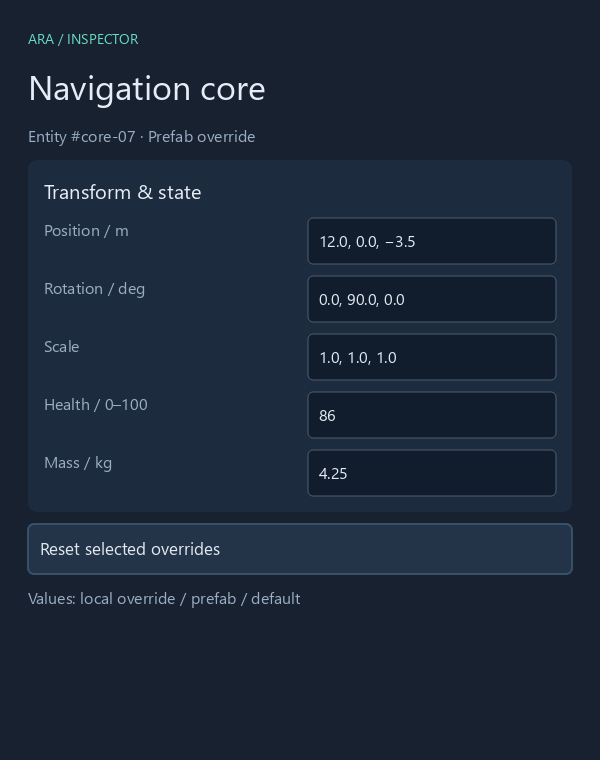
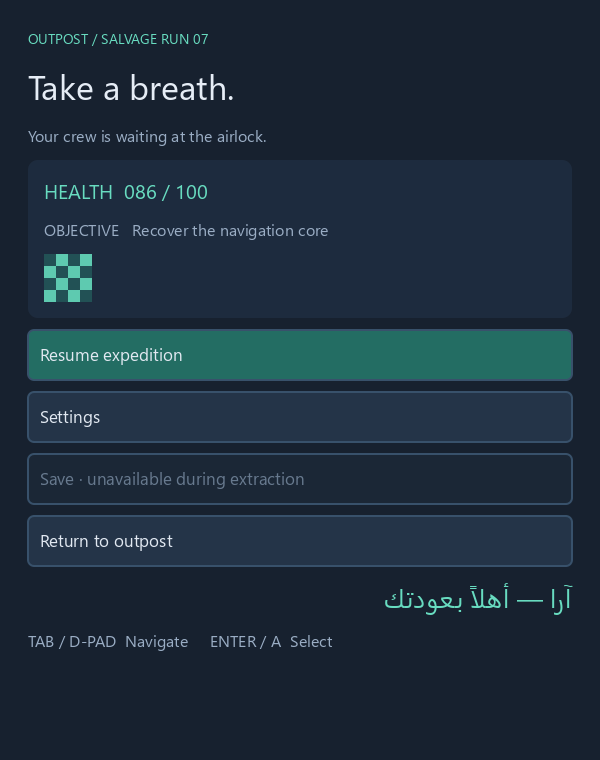
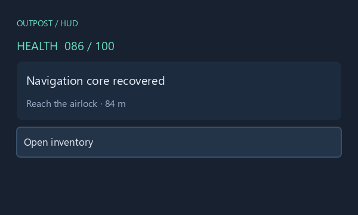
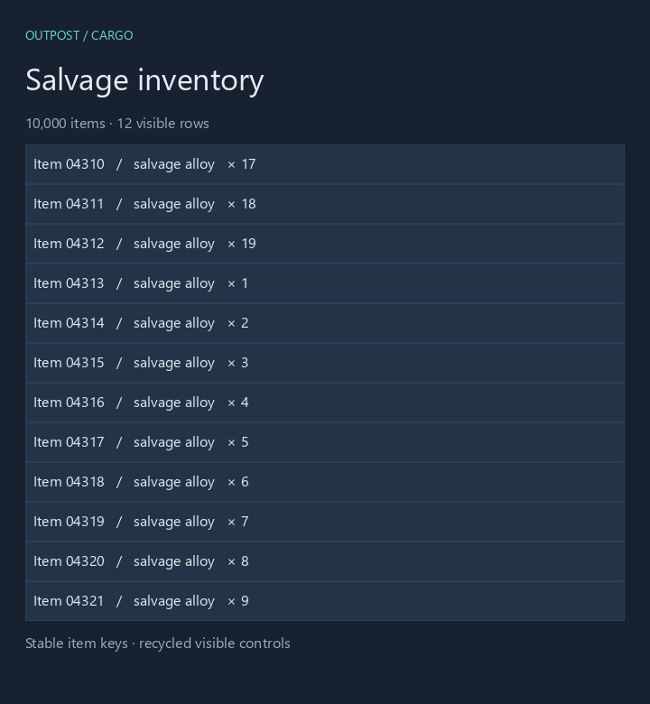
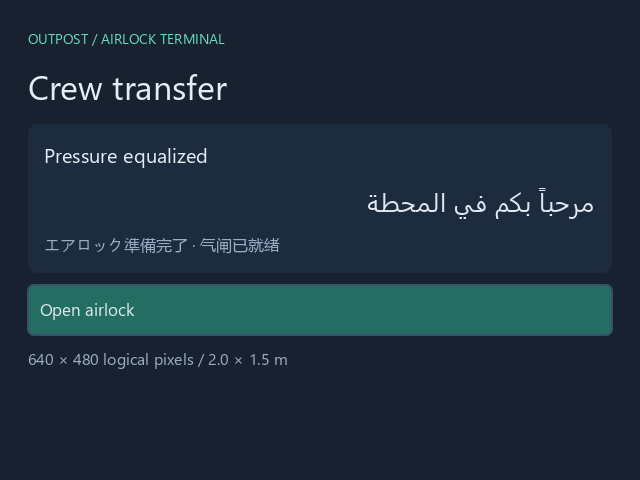
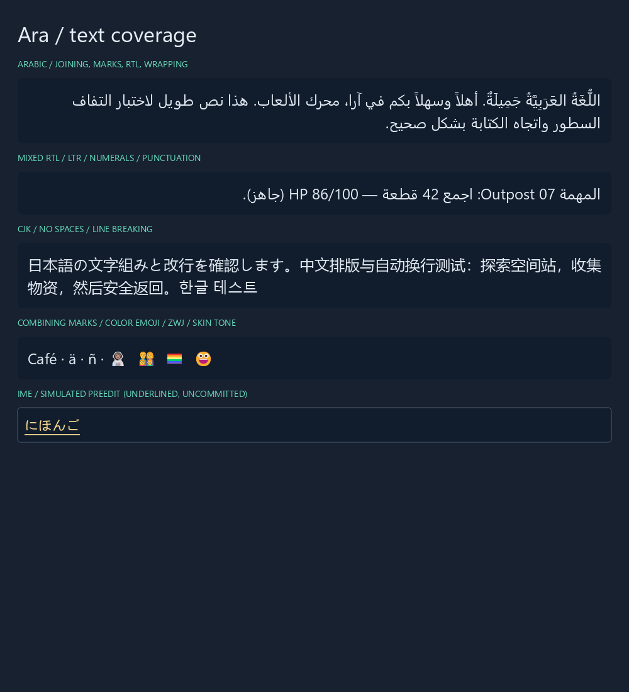
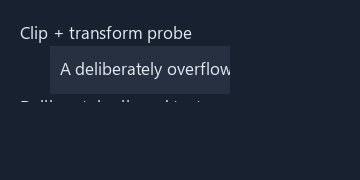

# S3 — Native retained UI runtime

Date: 2026-10-23. **PASS for the requested CPU-update, text-fixture, round-trip, focus, and AccessKit gates.** Recommendation: continue with an Ara-owned runtime using Taffy + Parley, preserving the renderer and text-provider boundaries. The evidence does not establish a production editor, OS IME integration, or GPU frame rate.

## What was built

A standalone Rust executable, outside the engine workspace. It parses strict XML-shaped markup and a deliberately restricted stylesheet into retained nodes; resolves tokens, widget defaults, specificity and local styles; measures through Taffy Flexbox/Grid and Parley; emits an engine-neutral display list; and rasterizes that list to PNG with tiny-skia and Swash. No browser, TypeScript, JavaScript runtime, C# runtime, ECS, window or GPU is involved in these captures.

Fixtures:

- A 23-node inspector generated from five schema fields, including labels, values and documentation used in AccessKit.
- A 14-node pause menu, and a separate seven-node HUD. A Rust `HudModel` models the future typed C# binding snapshot. Unknown binding fields are rejected.
- A 10,000-item inventory with exactly twelve visible row controls and eighteen total retained nodes. Scrolling preserves the nodes and shaped text for surviving item keys, recycles only entering rows, resets their input state, and updates document/tab order. Scrolling seven rows changes seven text layouts. There is no hidden tree of 10,000 elements.
- A 640 × 480 world-panel texture from the same runtime. A front-facing ray/plane intersection maps an orthonormal world basis and physical panel size to logical pixels. The center ray maps to `[320, 240]`; tests also reject parallel, outside and behind-panel hits. This is a texture/input proof, not a 3D renderer.
- A multilingual text laboratory, simulated IME preedit, and an intentionally overflowing translated/ clipped control probe.

Authored IDs are mandatory. A deterministic 64-bit hash of each authored ID supplies runtime/AccessKit identity; duplicate IDs and within-document hash collisions are rejected. Inventory identity comes from the model item key, independently of pool slot and source position.

## Exact commands

Run from the repository root in PowerShell. Prerequisites: the pinned Rust 1.96.0 toolchain, Windows fonts listed in [fonts.json](evidence/fonts.json), and network access for the first Cargo fetch. The Noto Naskh Arabic font is already installed on this machine; the executable reports an I/O error if a required font is absent. Fonts are not redistributed in this spike.

```powershell
$env:CARGO_BUILD_JOBS = '4'
cargo check --manifest-path spikes/s3-native-ui/Cargo.toml
cargo clippy --manifest-path spikes/s3-native-ui/Cargo.toml --all-targets -- -D warnings
cargo test --manifest-path spikes/s3-native-ui/Cargo.toml
cargo fmt --manifest-path spikes/s3-native-ui/Cargo.toml --all -- --check
cargo run --release --manifest-path spikes/s3-native-ui/Cargo.toml -- --samples 5000
```

The executable exits after writing captures, inspection/display-list JSON, semantic-check evidence and raw timing samples to `spikes/s3-native-ui/evidence/`. It returns an error on failed text coverage, source round-trip, focus, or translated-clip checks. To write elsewhere, append `--out C:/absolute/output/path`. `--samples` must be at least 100. Use the release profile for performance conclusions.

Optional independent HarfBuzz reference, using a local Python package directory:

```powershell
python -m pip install --target spikes/s3-native-ui/.vendor/python uharfbuzz==0.56.4 --disable-pip-version-check
python spikes/s3-native-ui/check-harfbuzz.py
```

RmlUi build/smoke, requiring Python/pip and Visual Studio **18 / 2026** C++ Build Tools plus a Windows SDK:

```powershell
powershell -NoProfile -ExecutionPolicy Bypass -File spikes/s3-native-ui/compare-rml.ps1
```

That script installs CMake 4.3.1 into `.vendor/python` if needed, fetches RmlUi commit `821cbd229d804cb1c905b729af86c21133abceee`, builds static libraries with four build workers and the font engine disabled, builds our headless smoke, and writes its JSON and diagnostic stderr. It makes no global installation. Visual Studio 17 / 2022 discovery failed on this machine; Visual Studio 18 / 2026 worked. Downloaded sources and build products are ignored. All started processes terminated.

## Measurement method and numbers

Machine: AMD Ryzen 7 7800X3D, 16 logical processors, 33,410,686,976 usable RAM bytes (31.12 GiB), RTX 4070 SUPER, Windows 11 Pro build 26300. The GPU is unused. Rust 1.96.0, release optimization, `CARGO_BUILD_JOBS=4`; dependencies are resolved in the committed lockfile: Taffy 0.15.0, Parley 0.12.0, Swash 0.2.10, tiny-skia 0.12.0, AccessKit 0.25.1. See [environment.json](evidence/environment.json).

Each case warms 200 iterations, then records **5,000 wall-clock samples with `Instant`**, including the model/scroll mutation, restyle, Taffy layout, Parley shaping/breaking and display-list rebuilding. Pause/HUD change health and toggle hover every iteration. Inventory advances seven whole rows per iteration and wraps at the dataset boundary. There is no sleep, frame limiter, affinity setting or outlier removal. JSON inspection, CPU rasterization and PNG encoding are excluded from that update budget. This is a shared machine, so wall time includes any descheduling; these are observed bounds, not hard real-time guarantees.

| Update workload | p50 ms | p95 ms | p99 ms | Maximum ms | Target / verdict |
| --- | ---: | ---: | ---: | ---: | --- |
| Pause: health + hover, incremental | 0.0155 | 0.0283 | 0.0510 | **0.3288** | ≤1 ms: **PASS**, including worst sample |
| HUD: health + hover, incremental | 0.0088 | 0.0152 | 0.0317 | **0.4088** | ≤1 ms: **PASS**, including worst sample |
| Inventory: seven-row scroll, incremental | 0.0711 | 0.1272 | 0.1812 | **0.6832** | ≤2 ms: **PASS**, including worst sample |
| Pause: deliberately invalidate everything | 0.0853 | 0.1616 | 0.2262 | 1.7548 | Comparison baseline, not the incremental path |
| Inventory: deliberately invalidate everything | 0.1463 | 0.2547 | 0.3509 | 3.0574 | Comparison baseline, not the incremental path |

Raw samples and fixture metadata: [measurements.json](evidence/measurements.json). The final typical work counters are one restyle / one shape / one layout call for pause and HUD; zero restyles / seven shapes / one layout call for inventory. Display-list rebuilding visits all fourteen, seven, or eighteen retained nodes respectively. Taffy's internal caches remain active; a “layout call” is not a claim that every node was recomputed. A focus-border-color-only change performs one restyle, **zero layout calls and zero shapes**.

Before preserving surviving rows, the inventory rebuilt twelve row texts per scroll. That recorded run had p50 0.1924 ms, p95 0.4174 ms, p99 0.8688 ms and maximum **4.4019 ms**, failing a strict worst-frame 2 ms gate. It is preserved in [measurements-before-recycling.json](evidence/measurements-before-recycling.json). The implemented fix reduces reshaping from twelve rows to seven and retains existing item identity; the focused test also proves a one-row scroll reshapes just one row. Differences in shared-machine load can affect the timing delta; the reduced work count is deterministic.

Cold frame updates, after source parsing and explicit font registration, ranged from 0.0912 ms for HUD to 3.9781 ms for the multilingual lab. First fallback/font-resource extraction is visible in the world panel's 2.3883 ms cold update. These are not the warmed change workload. Prewarm localization/font stories before activating a screen.

The reference rasterizer is **offline**, with no glyph atlas: final capture/raster/PNG time was 14.43 ms for pause, 19.70 ms for inventory and 29.42 ms for the text lab. It allocates masks and rasterizes glyphs repeatedly. It does not achieve 120 rendered fps. This spike proves the requested UI-update CPU budget; end-to-end 120 Hz rendering still needs the later `ara-gpu` adapter and GPU measurements.

## Criteria and implementation evidence

| Criterion | Result | Evidence |
| --- | --- | --- |
| Pause and HUD update ≤1 ms | **PASS** | Worst samples 0.3288 / 0.4088 ms in the final 5,000-iteration cases |
| Inventory scroll update ≤2 ms | **PASS** | Worst sample 0.6832 ms; 12 visible controls / 10,000 model items |
| Arabic, mixed bidi, CJK and emoji render correctly | **PASS for the fixtures** | Inspected native PNG; zero missing glyphs; cluster and direction checks; independent emoji HarfBuzz comparison |
| Designer byte-exact round-trip | **PASS** | No-op save, one-value byte patch, and inverse/undo all exact; comments, quotes, spacing, CRLF and Unicode covered |
| Focus navigation | **PASS** | Tab / Shift-Tab, directional navigation, disabled skip, modal focus restoration, clipped/translated pointer hits, reordered inventory tab order |
| AccessKit inspector tree | **PASS** | 23 actual AccessKit nodes, root info, bounds, labels, values, descriptions, children, actions and focused field |
| IME composition model | **PASS, simulated** | Start → Update preedit/selection → Commit; cancel and invalid range validation; event-driven preedit rendered and underlined |
| Structured inspection | **PASS** | Boxes, clips, overflow/clipped-text warnings, focus graph, glyph clusters, batch-break positions/causes as JSON |
| RmlUi comparison / quick build | **PASS** | Core + debugger static libraries built; custom headless integration smoke passed; limitations below |

Local gates passed: `cargo check`, Clippy all targets with `-D warnings`, all **six focused tests**, rustfmt check and `git diff --check`. The integration test exercises actual Parley/Taffy layout, Unicode cluster preservation, paint-only invalidation, AccessKit construction and item-preserving virtualization.

### Native captures

Verified by opening the actual PNGs: inspector fields align in Grid columns; pause controls and Arabic fit; inventory shows the expected twelve item keys; world panel has Arabic and CJK; the text lab joins Arabic and wraps RTL/CJK correctly; the probe clips glyphs and excludes pointer hits outside the translated viewport.









### Text findings and FFI decision

- Arabic fixture: **2 RTL lines, 131 glyphs, zero missing glyphs**. Joining and diacritics are visible in the PNG. Mixed fixture: **6 RTL runs and 3 LTR runs**, preserving English, numbers and parentheses within the Arabic paragraph.
- CJK fixture: **2 lines, 54 glyphs, zero missing glyphs**, including Japanese, Chinese and Korean. The first run exposed five missing Hangul glyphs; explicitly adding Malgun Gothic fixed the fallback chain. Shaping libraries do not supply fonts.
- Combining/emoji fixture: **28 glyphs, zero missing glyphs**. Tests require combining sequences and each ZWJ sequence to remain a whole text cluster, including the astronaut's skin tone, a family and rainbow flag.
- HarfBuzz **15.0.0**, through uharfbuzz 0.56.4, independently produces the same emoji glyph IDs as Parley: astronaut `[1540]`, family `[1283,1464,1271,1259]`, rainbow flag `[1071]`, smile `[2317]`. The family sequence is one cluster composed from four positioned glyphs in this installed font; it is not an accidental ZWJ split. See [harfbuzz-reference.json](evidence/harfbuzz-reference.json).
- The IME model uses validated UTF-8 byte ranges. The preedit is supplied to the field from simulated composition events and is visibly underlined. Commit writes `日本語`; cancellation preserves committed content. This does **not** test Windows TSF/IMM candidate windows, clipboard, replacement selections, a caret, or native keyboard/gamepad devices. The demonstration underlines the whole preedit-only field, not arbitrary composition spans in existing multiline text.
- Parley 0.12.0 uses **Harfrust 0.12.0** for shaping; this graph already includes **ICU4X segmenter 2.4.0**. No tested case requires HarfBuzz or ICU C/C++ FFI. Keep a provider seam rather than adding FFI without a failing case.
- Unproven coverage that could justify HarfBuzz FFI: broader Indic/SEA scripts, unusual font features/variation axes, specialized Arabic justification/kashida, and new color-font formats compared with upstream HarfBuzz/FreeType. Arabic paragraph justification was not tested. Missing fonts alone do not justify a shaper swap.
- Unproven coverage that could justify ICU4C FFI or additional ICU4X data: locale-tailored/dictionary word breaking, Thai/Khmer, full editor word navigation, Unicode bidi conformance/isolate corpora and locale formatting/collation. ICU4X data may suffice; do not assume FFI is necessary.
- M2 must choose licensed bundled fallback fonts and pin them for exports; the Windows-specific font paths and exact SHA-256 hashes are in [fonts.json](evidence/fonts.json). Full text editing, native IME, accessibility adapters and mobile platform coverage remain in the build order.

Full cluster/direction data: [text-coverage.json](evidence/text-coverage.json). Input and composition evidence: [input.json](evidence/input.json).

### Display lists and inspection

Commands contain only stable node/resource IDs, rectangles, colors, font IDs/sizes, positioned glyph IDs, ranges in a contiguous glyph arena, images, rectangular clip pushes/pops and translation pushes/pops. They contain no Taffy or Parley objects. Font data lives in a separate resource registry. A procedural checker texture exercises the image-resource boundary; there is no engine asset resolver here.

| Screen | Nodes | Commands | Batch-break/barrier events |
| --- | ---: | ---: | ---: |
| Inspector | 23 | 32 | 16 |
| Pause | 14 | 24 | 13 |
| HUD | 7 | 11 | 6 |
| Inventory | 18 | 45 | 27 |
| World panel | 9 | 16 | 9 |
| Text lab | 12 | 49 | 25 |

Breaks report pipeline changes, font/image texture changes, and clip/transform barriers while preserving painter order. These are conservative **potential batching boundaries**, not measured GPU draws. The first draw is not counted as a break; barriers are counted even if they do not separate two nonempty batches. A GPU atlas can combine font resources more aggressively. Do not infer GPU throughput from this table.

Examples: [inspector inspection](evidence/inspector.json), [inventory inspection](evidence/inventory.json), [world inspection](evidence/world.json), [display-list wire data](evidence/pause-display.json), [AccessKit tree](evidence/inspector-accesskit.json), [overflow/clip probe](evidence/clip-transform.json), [unsupported syntax diagnostics](evidence/diagnostics.json). The probe reports `overflow-parent` and `clipped-text-height` and verifies both visible and clipped pointer locations.

## Designer round-trip

`SourceDocument` retains original UTF-8 bytes. `SetAttribute { id, attribute, value, revision }` produces a `SourceOp` containing a byte range, before/after text and revision. Applying it checks both the revision and expected bytes, validates the resulting document, and increments the revision. Its inverse restores the original bytes. Attribute values are escaped for the existing quote style and XML whitespace normalization. This is the spike's single source writer.

A no-op save returns the exact original bytes. The real pause-menu edit changes only bytes `690..707` from `Resume expedition` to `Continue expedition`, leaving the rest of the file untouched. Tests additionally cover single quotes, entities, Unicode comments, CRLF, unusual spacing and stale-operation rejection. Evidence: [roundtrip.json](evidence/roundtrip.json), [edited source](evidence/pause-edited.ui).

This is a lossless source-document proof for **editing existing attributes**, not a finished designer. Insert/remove/reorder commands, stylesheet source edits, component definitions/instances, merge/rebase and undo-stack integration must extend this same typed-op path. Do not serialize the runtime element tree back over authored source.

## RmlUi: build or adopt?

The inspected upstream revision identifies itself as **6.4 development**, commit `821cbd229d804cb1c905b729af86c21133abceee`; do not equate it with a tagged stable 6.4 release. The quick build produced `rmlui.lib` and `rmlui_debugger.lib` with MSVC 19.50.35729.0. Our smoke initialized the core, loaded an RML document, updated an integer data binding through `DirtyVariable`, and emitted **4 geometry draw calls across two renders**. It rejected `display: grid` with a precise parser log. `GetInnerRML()` did not preserve the test comment. See [rmlui-smoke.json](evidence/rmlui-smoke.json) and [stderr](evidence/rmlui-stderr.txt).

**The quick build used `RMLUI_FONT_ENGINE=none` and a no-op renderer.** It proves buildability and basic document/binding/layout/render-interface integration. It provides no comparable frame timings, text-quality result, IME verification or visual RmlUi capture. The optional HarfBuzz reference above tests our font/shaping output, not the RmlUi HarfBuzz sample.

| Area | Ara spike / required contract | RmlUi evidence and adoption cost |
| --- | --- | --- |
| Document | Explicit IDs, strict XML-shaped `.ui`; text attributes; lossless source operations | Familiar RML document/DOM, mature controls/templates and C++ interfaces. Runtime DOM serialization drops the test comment, so Ara would still need a separate lossless source layer. |
| Styles/layout | Root tokens, restricted selectors, explicit diagnostics, Taffy Flexbox **and Grid** | RCSS supports considerably more styling/effects than this spike and has Flexbox, block/table layout. This revision's property registry and runtime reject Grid; adopting it does not meet A7's chosen Grid path unchanged. |
| Text | Parley performs paragraph bidi, shaping and breaking for all tested fixtures | Default engine uses FreeType; an optional sample replaces it with a HarfBuzz engine. Its inspected shaping configuration chooses script/direction from `lang`/`dir` or a first-character/script fallback. Full mixed paragraph bidi was not established by our build and needs a real validation corpus, not an assumption that “HarfBuzz = bidi.” |
| Bindings | Rust typed snapshot now; generated C# properties/actions in M2 | C++ `Bind` + dirty-variable notifications work in the smoke. C# ABI, schema validation, lifetime/threading and engine command routing remain Ara work. |
| Focus/input | Semantic keyboard/controller actions, active scopes, focus history and clipping-aware hit tests | Upstream supplies forms, spatial navigation and IME-capable backends. CommonUI-like screen-stack policy and engine SDL3 integration still need verification/adaptation. This is a substantial maturity advantage over our fixture code. |
| Rendering | Neutral ordered display list; later batches on `ara-gpu` | Replaceable native render interface, geometry retention, textures, clips, transforms and advanced effects. A renderer adapter is credible; our no-op adapter compiled and received geometry. |
| Accessibility | Actual inspector AccessKit tree generated from semantic controls | No AccessKit bridge was demonstrated by the inspected core/quick build. Ara semantic mapping and platform integration would still need implementation/verification. |
| Tooling | Agent JSON inspection, exact source patches, schema source for inspector | Upstream debugger and existing samples are useful today. Ara's source-preserving designer, typed C# contract, schema provenance, op review and structured agent diagnostics would remain product work. |

**Recommendation: build the owned runtime around Taffy + Parley; retain RmlUi as the comparison baseline.** Both options are native and compatible with D5/D6. RmlUi is the lower-risk way to obtain a broader control/effect catalog quickly, but it would not remove Ara's most specific work: lossless authoring, schema/C# bindings, AccessKit integration, screen-stack policy, agent inspection and renderer integration. Its missing Grid support also conflicts with the chosen A7 layout foundation. The measured owned path clears the fixture CPU gates with a small visible tree, and the Unicode tests reveal no reason to replace Parley now. This is a recommendation about architectural fit, not a claim that this spike surpasses RmlUi's production maturity or rendering speed.

## Proposed M2 crate structure

Use four real dependency boundaries; keep widgets/input/accessibility as modules rather than one crate per control:

1. **`ara-ui-document`** — lossless markup/stylesheet source, typed syntax diagnostics, stable authored IDs, compiled styles/tokens and revision-checked authoring commands/ops. No Taffy, font or GPU state. Integrate the engine document transaction system here; the designer never owns a competing asset representation.
2. **`ara-ui-text`** — font assets/fallback, reusable Parley contexts, paragraph/cluster layout, measurement cache and the narrow text-provider seam. Keep editing/IME cluster contracts explicit. No renderer or ECS ownership.
3. **`ara-ui`** — retained handles, Taffy layout, separate invalidation lanes, typed binding subscriptions, widget state, virtualized keyed lists, active input scopes/focus, hit testing, semantic/AccessKit output and JSON inspection. Its public paint module owns renderer-neutral display-list types and resource handles; it must not depend on `ara-gpu`.
4. **`ara-ui-render`** — consumes the display list and font/image resources, owns glyph/geometry atlases, clipping, premultiplied-alpha/color-space policy, batching and `ara-gpu` integration. A CPU reference adapter remains available for stories and captures. No document mutation or layout decisions.

The `ara` host owns SDL3 input/IME translation, AccessKit platform adapters, window/panel texture lifetimes and simulation-boundary command routing. The editor and game HUDs use the same runtime and renderer. World panels change the target surface/input mapping, not the document/widget implementation.

M2 should add native editable controls, glyph caches/atlas invalidation, bundled fonts, fractional list scrolling, explicit focus neighbors and restoration by surviving item key, transformed/rounded clipping, viewport/DPI changes, actual C# generated subscriptions and action dispatch. The full designer remains in M3, with the source-preserving foundation established in M2. These are build-order items, not dropped features.

## Proposed markup and stylesheet subset

The committed [pause.ui](assets/pause.ui) and [theme.css](assets/theme.css) are runnable examples. The executable supplies the file pair explicitly; stylesheet linking/import syntax is not implemented.

```xml
<!-- The designer edits this source through typed attribute operations. -->
<panel id="pause" class="screen">
  <text id="health" class="health" bind="Health" text="HEALTH  086 / 100" />
  <button id="resume" class="primary" action="Resume" text="Resume expedition" />
</panel>
```

```css
:root { --surface: #17212f; --accent: #68dcc0; }
.screen { width: 100%; height: 100%; padding: 28px; background: var(--surface); }
panel { flex-direction: column; gap: 12px; }
.health { color: var(--accent); font-size: 20px; }
button { height: 50px; border-width: 2px; border-color: #38516b; }
.primary { background: #236d63; }
button:hover { background: #34546a; }
button:focus { border-color: var(--accent); }
button:disabled { color: #67798e; }
```

Implemented grammar: `panel`, `text`, `button`, `field`, `image`, `progress`; every element has `id`. Attributes: `id`, `class`, `text`, `style`, `bind`, `action`, `disabled`, `src`, `label`. Text is in attributes, not mixed child content. Comments and authored formatting survive source edits. Unknown elements/attributes fail. `progress` is only a styled primitive in this spike, not a complete value/range widget.

Selectors are one type, `.class` or `#id`, optionally followed by exactly one `:hover`, `:focus` or `:disabled`. Specificity follows ID > class/state > type, source order breaks ties, and local `style` wins. Tokens are global `:root` declarations resolved with `var(--name)`, including cycle/depth detection. This subset has **no CSS inheritance**, nested selectors, combinators, selector lists, media queries, style imports or stylesheet-comment grammar. Arbitrary browser CSS is not accepted. Unknown classes can serve as semantic hooks; they are not a finite utility-class compiler.

Properties implemented: `display` (`flex`/`grid`), `flex-direction`, `flex-grow`, `width`, `height`, uniform `padding`/`gap`, `grid-template-columns` (space-separated `fr` tracks), `background`, `color`, `font-size`, `border-color`, `border-width`, `border-radius`, `overflow` (`hidden`/`visible`) and finite signed `translate-x`/`translate-y`. Width/height accept pixels, percentages and `auto`; other lengths use pixels. Overflow is paint/input clipping, not CSS scrollbar behavior. Transforms are translations only; clips are rectangular, even with rounded backgrounds. The CSS parser is intentionally small, not a browser compatibility layer.

Unsupported selectors/properties/states/tokens fail even in unused rules, with byte/line/column diagnostics; local-style errors name the node and property. Example: `CSS004 at byte 11 (line 2, column 11) in selector unused property position: unknown property position`. For M2, extend with logical start/end layout, minimum/maximum size, alignment/absolute overlays, component/variant tokens, font/language/direction controls, full affine transforms, image fit/nine-slice, and explicit action/binding schema validation. Keep all extensions specified and diagnosed.

## Proposed decision

> **S3 / retain A7:** Continue with one Ara-owned retained native UI runtime for editor, HUD and world surfaces, using Taffy 0.15 and Parley 0.12 behind owned boundaries. S3's fixture CPU, multilingual rendering, byte-preserving authoring, focus and AccessKit-tree gates passed on the Windows reference machine. Preserve surviving virtual-list items and shaped text; track restyle, layout/text and paint work separately. Do not serialize runtime trees over authored markup. Do not add HarfBuzz/ICU C FFI without a demonstrated coverage gap; keep a provider seam and expand the corpus. RmlUi is a useful native baseline, but its tested revision lacks Grid and does not eliminate Ara's lossless authoring, semantic and C# integration work. Full rendered 120 Hz, production controls, platform IME/screen readers, bundled-font portability and GPU batching remain M2/M3 verification gates.

Parent agent: add any accepted decision to `docs/decisions.md`; this spike deliberately leaves parent-owned docs unchanged.

## Primary references

- [Taffy 0.15 API and source](https://docs.rs/taffy/0.15.0/taffy/), [Parley 0.12 API](https://docs.rs/parley/0.12.0/parley/), [Swash scaling](https://docs.rs/swash/0.2.10/swash/scale/), [AccessKit 0.25.1](https://docs.rs/accesskit/0.25.1/accesskit/).
- [RmlUi upstream source](https://github.com/mikke89/RmlUi), specifically the pinned revision's `CMakeLists.txt`, `Source/Core/StyleSheetSpecification.cpp`, `Include/RmlUi/Core/{RenderInterface,FontEngineInterface,Element}.h`, `Samples/basic/harfbuzz/src/FontFaceHandleHarfBuzz.cpp` and README. [RmlUi render/font interface documentation](https://mikke89.github.io/RmlUiDoc/pages/cpp_manual/interfaces.html), [spatial-navigation documentation](https://mikke89.github.io/RmlUiDoc/pages/rcss/user_interface.html#nav).
- [HarfBuzz responsibilities](https://harfbuzz.github.io/what-harfbuzz-doesnt-do.html): shaping is separate from paragraph bidi, font fallback and the rest of a text system.
- Local research R05 and R07 §7, decisions D5/D6/A7. Unity reference code was studied read-only for style-cache/update and world-surface separation; none was copied. No third-party engine implementation is committed in this spike.
